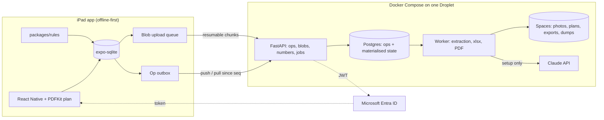

# PLAN.md — Field Survey: normative specification

Condensed from Phase 2 (architecture) and Phase 3 (UX) with Gate 3/4 decisions D49–D63 applied. Section numbers are cited from `TASKS.md`. Source history: `docs/history/`. Where this file and a history document differ, this file wins.

## 1. Architecture

| Layer | Choice | Decision |
|---|---|---|
| iPad | React Native via Expo (TypeScript), iPadOS 17+, iPad Air/Pro M-series or A14+; built by EAS from Windows, dev builds for daily work | D35, D70, D71 |
| Local store | `expo-sqlite` through a `SqlDriver` interface (`better-sqlite3` in Node tests); migrations in `packages/core`; FTS5 for search (bundled in expo-sqlite; verify in T07, fall back to LIKE) | D22, D71 |
| Sync | Custom op-log (append-only field-edit log) over HTTPS; server assigns `server_seq` and display numbers | D22, D25 |
| Plan viewer | `react-native-pdf` (PDFKit on iOS) with a Skia overlay in page coordinates for pins/ink; fallback only if TP-6 fails: server-rendered PNG tile pyramid + a zoomable image viewer | D19, D70 |
| Photos | JPEG q≈0.9 full-res, orientation baked, GPS stripped, first image of HEIC/MPO; 320-px thumbnail; HEIC not kept | D38 |
| Ink | Skia canvas with Apple Pencil pressure; one stroke-list JSON blob per (sheet, user); shared, read-only for others | D53, D70 |
| Sign-in | `expo-auth-session` PKCE against Entra ID (identity only, no roles), tokens in `expo-secure-store`; built last (start of M6); interim team-name picker + shared server token until then | D8, D31, D39, D69, D70 |
| Server | Python 3.12 / FastAPI / Postgres 16 / S3-compatible storage; one Compose deployment; worker shares the codebase | D23 |
| Hosting | DigitalOcean Basic Droplet 2 vCPU/4 GB with Postgres in Compose + Cloudflare R2 (≈ $25/mo), or the same stack self-hosted in the LTP office behind a Cloudflare Tunnel (G5-2); Caddy for TLS | D67 |
| Extraction | pdfplumber → tesseract (300 dpi) → Claude API structured outputs for riser endpoints, no-text pages, plan room names | D21 |
| Export | XlsxWriter workbook, WeasyPrint floor PDF, both server jobs | D18 |
| Distribution | TestFlight internal via `eas submit`; new build at least every 60 days | D59, D70 |

## 2. Data model

### 2.1 Principles

| Principle | Rule |
|---|---|
| Identity | Every record: client-generated UUID v7 `id`. Display identifiers (`01-S15`, `C-07`, punch `#12`, photo `7`) are separate fields, assigned once, never reused (D15, D25). |
| Numbering group | Counters (punch, part, photo, cable) live on `numbering_group`; a level points at one; 06 and 06M share (D33). Device IDs are per level. |
| Versioning | Record: `version`, `head_seq`. Per field: `field_head(entity_id, field, op_id)` — the op that last set it. |
| Soft delete | `deleted_at`, `deleted_by`, `delete_reason`; `restore` reverses. Deleted rows sync and keep history, drop out of lists/exports. Deleting a device leaves its items/parts/photos; lint flags orphans. |
| Audit | The op log is the only audit trail. Internal only (D51). |
| Vocabulary | Enum fields store the master's exact strings; `vocab` holds editable pickers; statuses/types/owners are fixed lists. |
| Baseline vs as-found | `origin` ∈ {`baseline`, `import`, `field_addition`, `library`, `manual`}; `found_on_site` ∈ {null, true, false}; per-level `baseline_locked_at` starts change logging. |

### 2.2 Entities

Bold = master column (name kept verbatim for export). `*` = server-assigned.

| Entity | Fields | Notes |
|---|---|---|
| `project` | id, name, site, parties{ec, etc, gc}, settings{export_title, disclaimer}, copied_from | Copies vocabulary, library, standing rulings, optionally placeholders |
| `level` | id, project, **Level**, floor_order, numbering_group, in_scope, split_of, **Surveyed**, **Updated**, state ∈ {`setup`, `baseline_locked`}, baseline_locked_at/by, display_sheet | `in_scope=false` levels exist as far ends and drive `Not started` |
| `numbering_group` | id, project, label, counters*{punch, part, photo, cable} | Move only on the server |
| `sheet` | id, level, kind ∈ {`display`, `source`}, blob, page, title, width_pt, height_pt, grid_sets[]{name, prefix, affine, col_labels, row_labels, mode ∈ auto/manual/none, residual}, revision | One PDF page per sheet; several grid sets per sheet (D47) |
| `user` | id, entra_oid (null for interim users), name, email, last_seen | Upserted on first API call; interim name-picker users are merged into the Entra user on first Microsoft sign-in (D69) |
| `assignment` | level, user, assigned_by, assigned_at | View filter + cache scope, not a permission |
| `device` | id, level, **ID**, **Category**, **Device**, **Type**, **Room / Location**, **Drawing Position**, **Status**, **Notes**, pin{sheet, x, y}, neuron_id (12 hex, unique per project), neuron_evidence_photo, neuron_method ∈ {typed, scan}, origin, found_on_site, baseline_ref, panel_name, library_type, version, head_seq, deleted_* | **Photo** column generated at export from `photo` links |
| `accessory` | id, device, model, expected_qty, found_qty, notes, source_ref | D27; NSPS power supply is an accessory (D52) |
| `cable` | id, project, **Cable**, **Qty** (nullable), origin ∈ {riser, library, import, manual}, single_row, riser_ref{sheet, bbox}, riser_to_label, vertical (grouping key), end_a, end_b, endpoint_confirmed (D6), version, deleted_* | One physical cable (D2) |
| `cable_end` | id, cable, side ∈ {A, B}, endpoint_kind ∈ {device, placeholder}, device, placeholder, level, **ID** (`C-nn`*, null until numbered), **From**, **To**, **Status**, **Note**, surveyed_by, surveyed_at, status_source ∈ {surveyed, copied, derived} | From/To generated once from templates then stored/editable (D32) |
| `placeholder` | id, project, label, kind ∈ {fixtures, power, station_bus, level_not_in_scope, external, fixture_run, spare, unknown, custom}, level? | Project vocabulary (D26); seed list §7.5 |
| `punch_item` | id, level, **#***, device, cable_end, device_text (the master's **Device** column text, kept by the import for reference and for an item linked to no device — D136, D148, D150), **Item**, **Type**, **Owner**, **Tracking status**, **Date closed**, **Notes**, rule_id, proposal_id, sort_last, version, deleted_* | **Photo** column generated at export; **Device** derived from the linked device (D148, D151), else `device_text` (D150) |
| `missing_part` | id, level, **#***, device, **Device / Location**, **Part**, **Part no.**, **Qty**, **Owner**, **Part status**, **Notes**, rule_id, proposal_id, version, deleted_* | **Source** generated at export from `part_source` |
| `part_source` | missing_part, target_kind ∈ {punch, device, cable_end}, target_id | |
| `photo_link` | photo, target_kind ∈ {device, cable_end, punch}, target_id (D128) | |
| `photo` | id, level, **Photo***, **Location**, **Subject**, **What it shows**, device (taken from), punch_item, cable_end (legacy single links, read as links), image_blob, thumb_blob, markup_blob (stroke-list JSON, same format as ink), taken_by, taken_at, seed_thumbnail_only (D40) | **Device ID** generated |
| `ink_layer` | id, sheet, user, drawing_blob (stroke-list JSON: points with pressure, width, colour, tool), updated_at | D53; writer = owner only |
| `blob` | sha256, size, mime, width, height, upload_state ∈ {local, partial, complete}, chunks_received | Content-addressed |
| `op` | §3.1 | |
| `review_item` | id, project, level, kind ∈ {sync_conflict, extraction, source_conflict, import_pair, lint, mss}, subject{entity, field}, op_a, op_b, candidates, state ∈ {open, resolved, dismissed}, resolved_by/at, resolution | |
| `ruling` | id, project, text, scope_levels, filter, action, standing, created_by/at, applied_at, op_count | §6.5 |
| `proposal` | id, project, rule_id, subject, discriminator, kind ∈ {punch, part, cable, status, note}, payload, inputs_hash, state ∈ {proposed, accepted, edited, rejected, superseded}, decided_by/at | |
| `finding` | id, project, level, lint_id, subject, message, state ∈ {open, resolved, dismissed}, dismissed_reason | |
| `import_batch` | id, project, kind ∈ {bom, riser, plans, master_xlsx, floor_xlsx, mss}, files, job_state, stats, created_by/at | |
| `draft_device` / `draft_cable` | per Phase 1f schema: level?, model/candidates[], category, qty, accessories[], source_ref{job, page, line|bbox}, level_basis, confidence, conflicts[], state ∈ {proposed, accepted, edited, rejected}, placed, not_on_sheet | |
| `library_type` | id, project (**nullable: null = app-level library**), model, aliases[], category, id_scheme ∈ {level_number, level_tag}, default_cables[], optional_cables[], optional_accessories[], state ∈ {draft, accepted, rejected}, created_by, promoted_from | D43, D48, D65 |
| `vocab` | id, project, list ∈ {device_note, punch_item, punch_note, part_note, connection_note, photo_caption, model_map, level_alias, category, type}, value, canonical_of | |
| `export` | id, project, kind ∈ {xlsx, floor_pdf}, params{levels}, blob (SHA-256 of the file, stored as a blob), job_state, stats{filename, rows…}, created_by/at, diff_summary | Export history; a job row (D137) |

### 2.3 Numbering

| Identifier | Scope | Assigned | Rule |
|---|---|---|---|
| `id` | global | client | never changes |
| Device **ID** | level code | **server, on first receipt of the create op** (D93, D118); a create that already carries an ID (seed import, setup placement from a drawing tag) keeps it | `<level>-<nn>` = highest ever used on that level code + 1 for panels/equipment; `<level>-S<n>` / `-D<n>` for stations/sensors = highest ever used for that letter + 1, no padding (D118); never reused; client shows `<level>-?` + `NEW` until assigned, the iPad never asks for a tag; unique per project (a duplicate is a lint, D76) |
| Punch **#**, part **#**, photo number, `C-nn` | numbering group | **server, on first receipt of the create op** | monotonic, gaps allowed, never reused; client shows `NEW` until assigned |
| Neuron ID item | numbering group | normal number | `sort_last=true`; exports order by (`sort_last`, #) |
| `server_seq` | project | server | total order of ops |

Fallback if the pilot shows numbers are needed offline: per-install reserved blocks of 20 per group (not built unless needed).

### 2.4 Level readiness (derived)

`setup_open` (unreviewed drafts) → `ready` (drafts resolved, baseline locked) → `surveying` (any as-found op). Lock allowed with warnings; unlock allowed with a typed reason and logged (D57).

## 3. Sync and reconcile

### 3.1 The op

| Field | Content |
|---|---|
| `op_id` | UUID v7, client |
| `project`, `user`, `install_id`, `client_ts` | who/where/when |
| `server_seq`*, `server_ts`* | assigned on receipt |
| `entity_kind`, `entity_id` | target |
| `kind` | `create` (payload = full record) · `set` · `delete` · `restore` · `link_add` · `link_remove` · `assign` (server-only) |
| `field`, `was`, `now` | for `set` |
| `base_op_id` | the field head the client had (null if never set) |
| `group_id` | grouped edits applied/reviewed together |
| `change_type` | `Field survey` · `Ruling` · `Reconcile` · `Correction` · `Riser cross-check` · `MSS ruling` · `Master edit` |
| `reason`, `ruling_id`, `proposal_id` | |
| `state` | `pending` · `applied` · `review` · `rejected` · `superseded` (`awaiting_approval` reserved, unused) |

### 3.2 Server apply (per push, one transaction, arrival order)

1. Assign `server_seq`; duplicates by `op_id` return `duplicate`.
2. `create`: insert; run `assign` for display numbers; never conflicts.
3. `set`: head = `field_head(entity, field)`.
   - head == `base_op_id` → apply.
   - head ≠ base, head.user == op.user → apply in `client_ts` order (D37).
   - head ≠ base, different user, different `now` → **conflict**: keep head value, op → `review`, create `review_item(sync_conflict)` with both ops.
   - identical `now` → apply silently.
4. `delete` vs newer `set` by another user, or `set` vs existing delete → review; `delete` vs `delete` → merge.
5. `link_add` always applies; `link_remove` vs newer `link_add` → review.
6. Ruling ops that conflict are flagged `ruling` on the review item.
7. Return per-op outcome plus `assign` ops.

Pull: `GET /ops?project&since=<server_seq>` → apply in order, update `field_head`; local pending ops on an incoming field mark the record "will be reviewed". Push: outbox in `client_ts` order, batches ≤ 500. Materialised local state; op table append-only, index `(entity_id, field)`.

### 3.3 Conflict rule per field type

| Type | Different values, different users | Same value | Resolver |
|---|---|---|---|
| Enum | Review | Merge | A / B |
| Free text | Review | Merge | A / B / Combine (pre-filled "A; B") |
| Number | Review | Merge | A / B / value |
| Field group (Tracking status + Date closed; Status + Note) | Review as one | Merge | A / B |
| Pin position | Review, both pins drawn | Merge | A / B |
| Neuron ID | Review + uniqueness lint | Merge | A / B |
| Links | add+add union; remove vs add → Review | — | keep / remove |
| Attachment, ink layer | Never conflicts | — | — |
| Delete / restore | delete vs edit → Review; delete vs delete → merge | — | restore / keep deleted |
| Server-assigned | not editable | — | — |

Resolution emits one `Reconcile` op by the resolver (`reason` auto-filled "Review: chose A (<user> <ts>) over B (…)"), marks the loser `rejected`, closes the item.

### 3.4 Attachments

Capture → JPEG + 320-px thumb → SHA-256 → `photo` record syncs at once, bytes follow. Upload: `POST /blobs/{sha}` → `PUT /blobs/{sha}/chunks/{n}` (2 MB, any order) → `GET /blobs/{sha}` (received chunks) → `POST /blobs/{sha}/complete` (hash check). Thumbnails first; backoff; survives restarts. Download: thumbnails and display sheets prefetch for assigned levels; full-size on demand, cached. Markup = separate stroke-list blob; flattened at export (the server renders strokes over the JPEG). Budget: ~25 GB per full tower.

## 4. Sign-in

**Interim (D69, until T03/T04):** the iPad shows a team-name picker on first launch (names from a `team` list on the server, editable); the chosen `user` is stamped on every op; every request carries `Authorization: Bearer <shared token>` from the server `.env` (`AUTH_MODE=token`). Switching to `AUTH_MODE=entra` requires no data migration: the server merges the interim `user` row into the Entra user by name on first sign-in (confirmation prompt on the iPad).

**Target:** Entra ID app registration "Field Survey" (public client, redirect `fieldsurvey://auth`, scopes `openid profile email offline_access` + `api://field-survey/access`). `expo-auth-session` authorization-code + PKCE; refresh token in `expo-secure-store`; silent refresh before each sync; interactive sign-in only when refresh fails and the iPad is online. Editing never needs a token; sync, setup uploads and exports do. Server validates the bearer JWT against tenant JWKS, upserts `user`, no roles. Everyone is in the LTP tenant (D39).

## 5. UX (from Phase 3 wireframes; §numbers refer to `docs/history/Phase3_UX_Wireframes.md`)

| Screen | Key behaviour |
|---|---|
| Sign-in → Projects → Project home (§4.1) | Levels table: state, device count, Issue/NI, open items, review count, cache state; "Assigned to me" filter; sidebar to Cable/riser, Needs review, Dashboard, Rulings, Lint, Export, Setup, Library, Sync |
| Plan view (§4.2) | Left ~72 % plan, right ~28 % side panel (D44, D105); pin shape by category, fill colour by status (D64), label = device type, not the ID (D119); filters by category/status/owner/open punch persist per level (no "mine" filter; Owner = open punch/part owner, D99); layers: pins, labels, boundaries (data from T45), ink (all users), photos-as-pins (camera mark at the device, D100); clustering at low zoom; long-press → add device / note / photo / ink, the menu shows while held and the spot follows the finger until it lifts (D114, D117); draw mode for ink with Pencil pressure — one finger or the Pencil draws, two fingers pan and zoom — Undo through every change (D115, D116, D129, D132) |
| Device card (§4.3) | Status buttons, Notes with vocabulary chips, accessories expected/found, Neuron ID (type or scan), photos, connections with jump, punch items + proposals (Accept/Edit/Reject, "why?"), missing parts, quick actions E6/E7/E9/"Not found on site", history. Edits commit per tap (D45), no Save button |
| Photo (§4.4) | Camera opens straight away; caption after the shutter; Skia markup over the image (stroke-list blob, `packages/core/docs/strokes.md`); original untouched; a photo is taken from one device and linked to any number of further devices, connection ends and punch items, picked nearest first (`photo_link`, D128, D131); the library picker opens from the plan, not over the photo screen (D112, D117) |
| Connection end (§4.5) | This end / other end stacked, both editable (status, note, From/To); vocab notes; riser label check; jump pushes the other level's plan, which falls back to the list when its sheet is not downloaded (D113) |
| Neuron ID scan (§4.7) | M7: `react-native-vision-camera` + a text-recognition frame-processor plugin, 12-hex filter, 3-frame agreement, O/0 B/8 flags, duplicate check, evidence crop. MVP: typed entry with the same validation |
| Cable / riser view (§5) | Group by vertical / level / code; both ends; checks: missing far end, code mismatch, status mismatch, To ≠ riser, unconfirmed endpoint, Not started on in-scope level |
| Needs review (§6) | Tabs by kind; A/B side by side with who/when/install; Choose A / Choose B / Combine; pin conflicts drawn on the plan |
| Dashboard (§7) | The four Summary tables + stacked bar charts (`victory-native`); drill-down to filtered lists (D17); as-found counts; readiness; global FTS search |
| Rulings (§8) | Reason, scope, filter builder, action (set / rename phrase / append note / generate item), standing toggle, preview table with untick, apply → Ruling ops |
| Lint (§9) | Findings grouped by check; dismiss with reason; "fix all via ruling" |
| Library (§10) | Two scopes (D65): the **app library** (opened from the Projects list, no project needed) and the **project library**. Types with aliases, ID scheme, default/optional cables, optional accessories; drafts usable immediately, flagged until accepted (D48); free-typed field-addition models create project drafts (D55); "Promote to app library" on accepted project types; new projects copy from the app library. The app library syncs on its own op log, `/library/ops` (D184): same op format, review and history as a project, offline too |
| Setup (§3) | Create project → Levels (with "Add range") → Sources (BOM, riser, per-level display + source sheets, seed import, extraction job) → Review drafts per level with source crops and mismatch list → Place devices from the unplaced list with ID/tag/Drawing Position/Room confirm → Lock baseline per level |
| Export (§11) | Workbook: levels, tabs, pre-flight (lint, review, unsynced); server job; history with diff vs previous. Floor PDF: options per §8.7 |
| Sync & uploads (§12) | Connection, last sync seq, pending edits, photos waiting, cached levels, storage, install/app version, re-sign-in, export local log |

Record badges: `NEW`, `↑n`, `IN REVIEW`, `DRAFT`, `DELETED`, `📷 n waiting`, `⚑ rule`.

## 6. Rule engine (`packages/rules`, client only — D24)

Pure TypeScript over an in-memory project snapshot (no DB, no React; the same package can later run on the server or in a web dashboard). Runs debounced after each committed edit and after each pull. Outputs `proposal` and `finding`. Proposals keyed by `(rule_id, subject, discriminator)` + `inputs_hash`: never duplicates; rejected stays rejected until inputs change; a proposal whose condition disappears → `superseded`. Accept → record with `rule_id`; Edit-then-accept → `edited`.

### 6.1 Rules

| Rule | Trigger | Output |
|---|---|---|
| R1 | Device status or its ends/items change | Findings: "Installed, untested with outstanding wiring/termination" (suggest Issue); "Issue device with no open punch item"; "Complete used" while `completion_phase=false` |
| R2a | End status set | No auto-filled Note (D172): "Not run" (Not installed) / "Run, not terminated" (+ "; no term kit" when X) are offered as chips; lint on mismatch |
| R2b | End endpoint ≠ `riser_to_label` | Finding "To does not match the riser" |
| R2c/R2d/R2e | Library | 0-10V single row To `Fixtures`; P single row To `EBDK panic wire`, default `Installed, untested`; 120V single row (NSPS `P-NSPS-D Power Supply`, rack `Equipment rack` — D52); one Unison pair per level `Stations & Sensors` ↔ NSPS (or rack where no NSPS) |
| R2g | Accepted device type with default cables (T48, D183) | Each of the type's default cables a device lacks, as a `cable` draft with the type's From / To / far end; for that type's devices it replaces R2c/R2d (R2e's per-level Unison stays). A device's type is its `library_type`, else the type whose model or alias is its Device text |
| R2f | Other end surveyed, this end not | Nothing is copied (D171): the end stays empty (`Unsurveyed`, D110/D138) until someone surveys it; far level out of scope → `Not started` |
| R3a | End `Not installed` | Punch "Run <signal> to <other end>", `Cable not run`, `EC`, surveyed end only (E3) — one per wire: with both ends surveyed, on the start of the run (side A, D177); → Termination item when the end becomes Issue |
| R3b | DMX end Issue "no term kit" | Device item `Terminate DMX to <far end>`, `Missing part`, `EC/ETC`, Notes "Waiting on DMX Termination Kits" (the master's form, D175) |
| R3c | Numbering group exists | "Missing all Device Neuron IDs", `Information`, `EC`, `sort_last`; Notes = IDs with null `neuron_id`; auto-close when empty, reopen on a new device without ID (D49) |
| R3d | Item text | Finding on "test"/"commission" |
| R3e/f | Item editor | Phrase picker from `vocab(punch_item)`; lint "outside vocabulary" (dismissable) |
| R4a–d | Part created / R3b accepted / saved | Owner `EC`; "DMX termination kit - <destination> run" Qty 1 Needed "Need to be ordered" with `part_source`; default Notes by kind; lint on re-pull/network-kit parts |
| R5 | Far level `Surveyed` null | Suppress R3a/R3b/R4b for that end |
| E5 | Accessory ERP-FT-LVD found < expected | 0-10V end Issue "Not landed"; punch "Land 0-10V control wiring" |
| Acc | Any accessory found < expected | Finding (D52, proposal) |
| E6/E7/E9 | Quick actions | Closed Information "Reterminated - all good"; Not installed + Information "Confirm …"; append "; moved from <room>" |
| E12 | MSS import (M7) | Disagreement → `Missed Survey` "check" item |

### 6.2 Library (seed, from this project's Connections)

| Type | Generated cables |
|---|---|
| Relay panel CTxxLCPA/B | 0-10V → Fixtures (single); P → its EBDK (single, paired by panel name) |
| NSPS P-NSPS-D(-KIT) | 120V (single); U bus pair; accessory: power supply expected 1 for -KIT (D52) |
| Equipment rack | 120V (single); U bus pair on levels without NSPS |
| Riser-run devices | cables come from riser drafts, not the library |

Anything else enters as a draft (D43/D48).

### 6.3 Lint checks

NSPS/rack without 120V · relay panel without P or 0-10V · Issue device without open item · item without Owner · Neuron ID item missing/not last · value outside vocabulary · cable with missing far end · ends with different code or incompatible statuses · To ≠ riser · duplicate Neuron ID · link to deleted device · pin outside sheet · level locked with unreviewed drafts · accessory found < expected.

### 6.4 Rulings

`ruling{text, scope_levels, filter, action, standing}`. Preview = computed op list (Level · Ref · Field · Was → Now), untickable. Apply emits ops `change_type=Ruling`, `reason=text`, `ruling_id`. Standing rulings re-evaluate on new matches and raise proposals. Rename rulings update `vocab.canonical_of`. Stored shape, untick (`except`), the vocabulary rule and the standing proposals: D179, `packages/rules/docs/engine.md` (T37).

## 7. Import, extraction, export

### 7.1 Pipeline

Upload → per-file job → text layer? pdfplumber : 300-dpi tesseract → deterministic drafts with `source_ref` → Claude API (structured outputs, `additionalProperties:false`) for riser endpoints per band crop, rack output stacks, no-text pages, plan room names → validation (pooled BOM totals = Σ riser placements; card counts = accessory qty; faceplates = stations; EBDK↔ERP pairing; BOM≠riser qty → conflict, never auto-resolved — D28) → drafts synced → per-level review (<0.7 or flagged → Needs review, D11) → place → lock.

### 7.2 BOM (PDF only, D5)

Column bands from headers; `dedupe_chars`; VENUE rows group; Material List format → project pool. OCR fixes table. `vocab(model_map)` strips `-4Z/-4/-5`, `P-DOC-W-WD`→`P-DOC-W`; SR vs LR → both candidates (D28). `vocab(level_alias)`: `Level 5`→06M. Rack component lines → one Equipment rack draft. Accessories per D27. Non-device lines `excluded`, promotable (D12). Pooled venue → level from riser (D10).

### 7.3 Riser

Separator lines → level bands; fragment merge; devices by tag; bubbles = wire ID, counted by geometry; one `draft_cable` per bubble; endpoints via Claude per band (≤2000 px crop) with the band's device list; rack outputs → `fixture_run` placeholders; sheet 002 → OCR/vision. Reviewer must **Confirm endpoint** per cable (D6).

### 7.4 Plans and grid

Per level: one display sheet (composite) + N source sheets (D29). pdfplumber words → grid bubbles, room codes/names, panel tags. Per grid set (D47): column/row label positions → least-squares affine; `auto` if residual < 2 pt else manual (tap 3 bubbles); prefix per set ("WT"). Drawing Position from pin: "Grid B-C / 9-8" style, "East of H" beyond last column; editable default. Panel tags → dashed pre-placement proposals; stations/sensors always by hand. Room nearest pin → default Room / Location. Embedded raster images ignored (A11).

### 7.5 Seed import (master/floor workbooks, D30)

| Tab | Mapping |
|---|---|
| Devices | → `device` (`origin=import`, ID kept, panel_name parsed) |
| Connections | → `cable_end`s paired into cables by (code, level cross-reference, labels) with a confidence, paired at ≥ 0.8 (D126); single-row codes → one cable; a To text naming an out-of-scope level or a seed placeholder → that placeholder far end; otherwise unpaired → own cable with an unresolved far end + `import_pair` review listing the candidates (D126); From/To verbatim; the four Unison spellings → rename ruling to `Stations & Sensors` recorded at import (D50) |
| Punch List | → `punch_item`; Device text matched by ID prefix; a row linked to no device → `review_item(lint)` `import.punch_device_unmatched` for Needs review (D148); Neuron ID row → `sort_last` |
| Missing Parts | Source parsed (`Punch #8-14`, `#15, #19`, `Devices 06-S3`, `Connections C-06`) → `part_source`; unparsed → finding |
| Photo Log | → `photo` with the 320×240 image, `seed_thumbnail_only` (D40) |
| Change Log | → historical ops (`user="import"`, state `superseded`: recorded, shown in History, never materialised — D124), not re-logged; never exported (D51) |
| Summary/Lists/Floor Order | not imported (D16); levels and dates from Summary |
| Counters | set to max per tab; 06/06M merged (D33) |
| Checks | column-mapping UI pre-matched; out-of-list values → Needs review; BOM/riser-derived drafts vs imported rows → `source_conflict` |

Seed placeholders: `Fixtures`, `120v Power`, `Stations & Sensors`, `Level 09`…`Level 12` (level_not_in_scope), `Walter Tower ETC P-CCS` (external), `B3A Canyon` / `C13A Oculus` / `D1 ED Column Capital` / `B3B Elev Core C fixture` / `B7 Stair A fixture` (fixture_run), `Spare DMX out`, `Missing DMX run (one per UFMP4)` (unknown).

### 7.6 Excel export (XlsxWriter) — must match `fixtures/Lighting_Control_Survey_Master_B2-06_4.xlsx`

| Item | Spec |
|---|---|
| Tabs | Summary · Devices · Connections · Punch List · Missing Parts · Photo Log · Lists (no Change Log — D51); no macros; Arial 10 data, 14 bold titles; wrap on text columns |
| Titles | Row 1 tab title (Devices / Connections / Outstanding items / Missing Parts / Photo Log); row 2 `Levels <first>-<last>` (06M folds into 06); headers row 3; data row 4; freeze panes C4 |
| Tables | `Devices`, `Connections`, `PunchList`, `MissingParts`, `PhotoLog`; `TableStyleLight1`; autofilter |
| Columns and widths | Devices: Level, ID, Category, Device, Type, Room / Location, Drawing Position, Status, Notes, Photo, Floor Order (8, 10.4, 15, 20.3, 41.3, 50, 40, 20, 64.4, 8). Connections: Level, ID, From, Cable, To, Qty, Status, Note, Floor Order (8, 10.4, 29, 8, 40, 7, 20, 66.9, 8). Punch List: Level, #, Device, Item, Type, Photo, Owner, Tracking status, Date closed, Notes, Floor Order (8, 10.4, 49.1, 52, 15, 8, 10, 16, 12, 57, 8). Missing Parts: Level, #, Device / Location, Part, Part no., Qty, Owner, Source, Part status, Notes, Floor Order (8, 11.4, 32, 42, 14, 7, 10, 32, 14, 44, 8). Photo Log: Level, Photo, Location, Subject, What it shows, Device ID, Floor Order, Image (8, 10.4, 32, —, 70, 16, 8, 46) |
| Validation | Devices!H4:H2000 `=Lists!$A$2:$A$6`; Connections!G4:G2000 `=Lists!$D$2:$D$7`; Punch List!H4:H2000 `=Lists!$B$2:$B$4`; Missing Parts!I4:I2000 `=Lists!$C$2:$C$5`; Lists columns Device status / Tracking status / Part status / Connection status |
| Rows | Connections: one row per `cable_end` on in-scope levels, by level then C-nn; single-row cables once. Punch by (`sort_last`, #). Source text from `part_source`. Photo text = numbers joined ", ". Floor Order from level order |
| Summary | A1 `ETC Lighting Controls Survey`; A2 levels; A3 `Surveyed <min> to <max>`; A4 disclaimer; tables rows 6–16 (Device status by floor), 18–28 (Outstanding by floor), 30–35 (by owner), 42–52 (Missing parts by floor); `SUMPRODUCT` over rows 4–2000 as the master; four stacked column charts 15×7.5 cm at J6, F18, F30, G42 with 5/3/3/4 series |
| Photo Log | Image column H, 320×240, markup flattened, row height fitted |
| Acceptance | TP-4 cell-by-cell diff empty except D50 spelling and the absent Change Log; opens in Excel Online and Excel for Windows, and in Excel for Mac whenever a Mac is available (TP-5, D72) |

### 7.7 Floor PDF (WeasyPrint, D56, D66)

Dense layout: tables run several items per page with inline thumbnails; no single-item pages; sections flow without forced page breaks. Finalise against Landry's example report when attached (G5-1).

Cover: "ETC Lighting Controls Survey — Level NN", "Surveyed <date>" only (R7), status counts table, plan snapshot with status-coloured, category-shaped pins labelled by device type (Type, else Device, else category — D119/D120) and all users' ink flattened. Then: findings (devices with Status ≠ Installed, untested: ID, Device, Room, Status, Notes, thumbnails); connections for the level; punch list ordered (`sort_last`, #); missing parts; photo appendix 2×3 grid, caption "Photo n — <Subject> — <Device ID>".

### 7.8 MSS (M7, blocked on the file — A4)

`import_batch(kind=mss)`, match by device ID/level, disagreements → `review_item(mss)` → Missed Survey "check" items (E12).

## 8. Server API (summary)

| Route | Purpose |
|---|---|
| `POST /ops` · `GET /ops?project&since` | push / pull (§3.2) |
| `POST /blobs/{sha}` · `PUT …/chunks/{n}` · `GET /blobs/{sha}` · `POST …/complete` · `GET …/content` | resumable blobs |
| `GET /projects` · `POST /projects` (+ levels, copy-from) | project list and creation (server-side so numbering groups exist before any op); the project, its groups, levels and copies are written as ops so an iPad pulls them (D127) |
| `POST /imports` · `GET /imports/{id}` | setup and seed jobs; drafts delivered as ops |
| `POST /exports` · `GET /exports/{id}` · `GET /exports?project` · `POST /exports/{id}/cancel` | workbook / floor PDF jobs and history; one queued or running per project and kind, stage and counts in `stats`, Cancel (D166) |
| `GET /me` | user upsert from JWT |
| `GET /health` | |

All routes need a bearer token except `/health`. Jobs run in the worker (same image, `python -m app.worker`), state in Postgres, artifacts in Spaces.

## 9. Deployment and operations (D67)

One Compose stack: `caddy`, `api`, `worker`, `postgres:16` (named volume), SeaweedFS (S3 API) for local dev only (MinIO's images left Docker Hub, D87); object storage = Cloudflare R2 (S3 API) in every non-dev environment. **Option A:** DigitalOcean Basic Droplet 2 vCPU/4 GB, Caddy terminates TLS for `survey.<domain>`. **Option B:** the same stack on an always-on machine in the LTP office, exposed through a Cloudflare Tunnel (no inbound ports); Caddy runs plain HTTP behind the tunnel. Worker runs one job at a time (`WORKER_CONCURRENCY=1`) so tesseract/WeasyPrint fit in 4 GB; add 2 GB swap. Backups: nightly `pg_dump` to R2 (90-day lifecycle) + daily master export to R2, skipped when nothing changed, kept six months (D149, D152) + weekly copy to a second R2 bucket. Restore drill once in M0 (T06). Updates: `git pull && docker compose up -d --build`. Monitoring: `/health` pinged by an external monitor; worker heartbeat row.

## 10. Test plan reference

TP-1 twin-iPad offline edit then sync · TP-2 airplane-mode day · TP-3 2,000 devices / 10,000 photos · TP-4 import→export diff · TP-5 Excel Online + Windows (+ Mac when available) · TP-6 PDFKit on the 06M composite · TP-7 sync resilience · TP-8 rule golden tests · TP-9 extraction regression · TP-10 numbering never reused · TP-11 delete/restore · TP-12 sign-in offline. Full table in `docs/history/Phase4_Delivery_Plan.md` §4.
