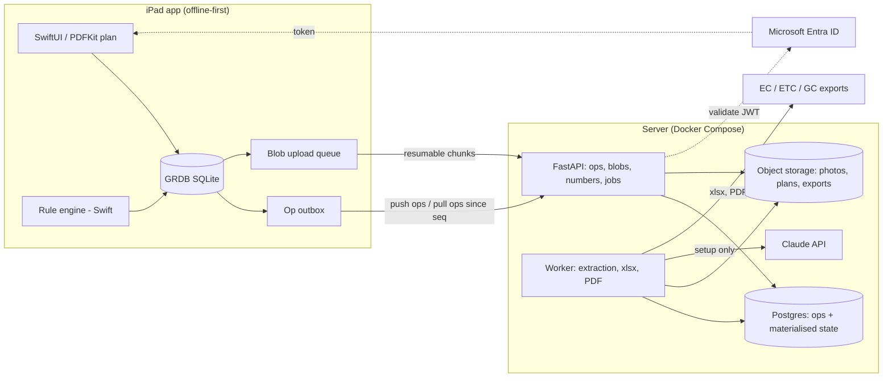
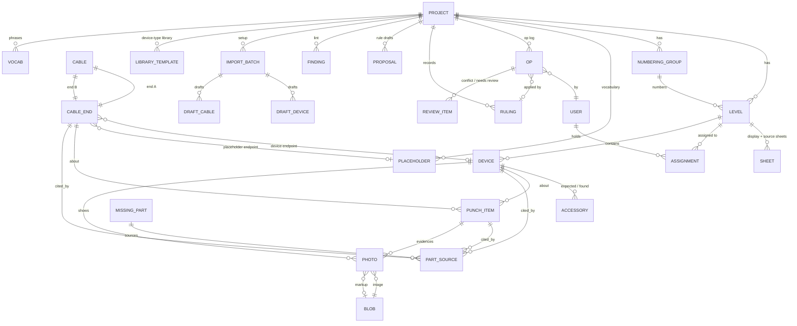
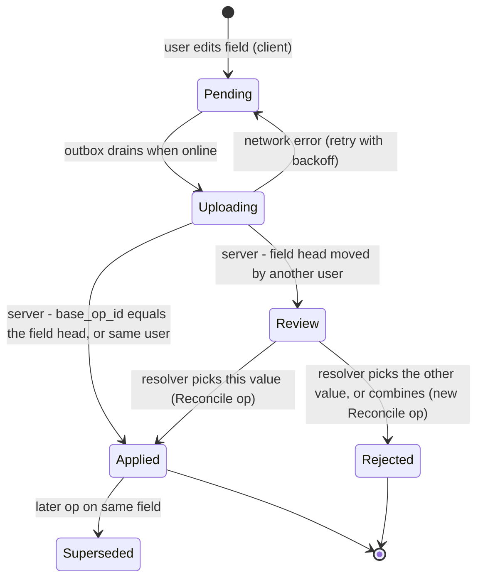
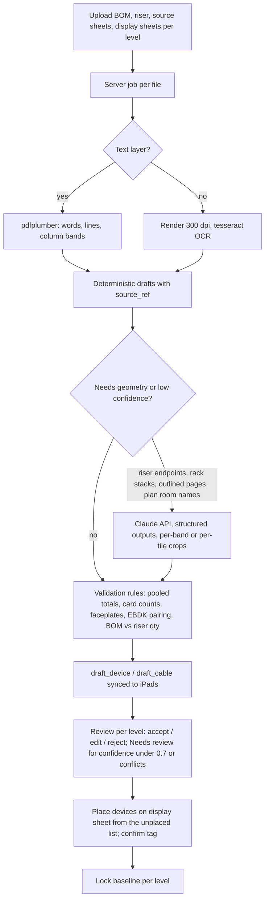

# Survey iPad App — Phase 2 (Gate 2): Architecture and data model

Date 2026-10-09. Inputs: `Fable_Prompt_Survey_iPad_App.md`, `Lighting_Control_Survey_Master_B2-06_4.xlsx` (re-inspected for export and library details), project docs `Gate1_Phase0_Understand.md`, `Phase1_Research.md`, `Phase1f_Extraction_Test.md`. Web search used once, to confirm MSAL for iOS installs via Swift Package Manager (§5). Everything else is from the attachments and your answers. Proposals that go beyond them are marked **(proposal)**.

New fact from the workbook this phase: **06 and 06M share one numbering sequence on every tab** (Punch 06M #1–12, 15–17 and 06 #13, 14, 18; Missing Parts 06M #1–13, 06 #14–15; Photo Log 06M 1–3, 06 4–6; Connections C-01…C-25), and the 06 group's Neuron ID item is #18, attributed to level 06. The model below calls this a *numbering group*.

## 1. O1–O9 answers → decisions

| # | Your answer | Decision / consequence |
|---|---|---|
| O1 | Placeholders must be dynamic; no complete list yet | **D26** Placeholder endpoints are a per-project vocabulary table, seeded from the master's non-device From/To values (§3.4) and extended from the endpoint picker. |
| O2 | Neuron IDs are unique to the devices; punch numbers etc. should never be reused | **D25** Every display number is assigned once by the server and never reused or renumbered. Neuron ID becomes a unique field on Device. The "Neuron ID item stays last" rule is met by a `sort_last` flag on that item, not by renumbering — **confirm (G2-3)**. |
| O3 | Yes | **D27** Accessory entity added (§3.3). |
| O4 | A human verifies and decides | **D28** When BOM and riser disagree (model or qty) the draft carries both candidates with sources; nothing is auto-picked; the draft sits in Needs review until a person chooses. |
| O5 | Composite was built because the real plan is 6–7 sheets; UI uses whole-floor composites, import uses the original sheets; some projects are one floor | **D29** A level has one *display sheet* (composite, for pins and markup) and zero or more *source sheets* (originals, for extraction). A one-floor project has the same file as both. |
| O6 | Master counts came from survey findings; flag as a conflict for verification | **D30** Seed import of the master is this project's baseline; where BOM/riser totals differ from it (L01 PI1004, L03 ceiling sensors) a Needs-review item is created, nothing auto-resolved. |
| O7 | Not understood | Restated in plain words in §9 (G2-1). A3 stays open. |
| O8 | Not understood | Restated in §9 (G2-2). |
| O9 | Microsoft single sign-on | **D31** Sign-in = Microsoft Entra ID via MSAL for iOS; identity only, no roles (D8). |

## 2. Recommended stack

### 2.1 Components

| Layer | Choice | Why |
|---|---|---|
| iPad app | Swift 6, SwiftUI (UIKit where PDFKit/PencilKit need it), iPadOS 17+ | Native PDFKit, PencilKit, VisionKit, camera; one codebase |
| Local store | **GRDB (SQLite)** | Mature, migrations, FTS for search, `ValueObservation` drives SwiftUI; no sync vendor |
| Sync | **Custom, op-log based** (§4) | The field-edit log the prompt already requires *is* the sync protocol, the conflict detector and the Change Log — one mechanism instead of three |
| Plan viewer | PDFKit `PDFView` + overlay in page coordinates; `CATiledLayer` tile fallback (D19) | Per 1b; prototype on the 06M composite (153K segments) in Phase 4's first milestone |
| Photos | Camera/library → JPEG (orientation baked, GPS stripped, first image of HEIC/MPO) → content-addressed blob; PencilKit markup stored separately | Per 1b |
| Label scan | VisionKit `DataScannerViewController` + Vision text, 12-hex filter, 3-frame agreement | Per 1e |
| Sign-in | MSAL for iOS (Entra ID) | Your SSO choice (O9) |
| Server | **Python 3.12 / FastAPI**, Postgres 16, S3-compatible object storage, one Docker Compose deployment, background job worker (same codebase) | Extraction (pdfplumber, tesseract, Anthropic SDK) and export (XlsxWriter, WeasyPrint) are all Python → one server language |
| Hosting | One small VPS or PaaS; managed Postgres and bucket versioning for backups; nightly `pg_dump` + weekly automatic master export to the bucket | "Never lose data" with minimal ops; prices to be verified in Phase 4 |
| Extraction | Deterministic parse → OCR → Claude API (structured outputs) for riser endpoints, no-text pages and plan room names (D21) | Per 1f |
| Export | XlsxWriter + WeasyPrint on the server (D18) | Per 1c |



### 2.2 Sync trade-off (closes D20)

| Criterion | GRDB + custom op-log sync (**recommended**) | PowerSync Pro + Postgres | Note |
|---|---|---|---|
| Field-level review queue | Native: every op is a field edit with a base version; conflict detection is one comparison | Not provided; we still write the op log and the review logic, PowerSync only replicates the result | The hard part is ours either way |
| Change Log (R6) | The op log *is* the change log | Separate table we maintain | |
| Display numbers assigned once (D25) | Server assigns on first receipt of a create op | Needs a custom backend connector call | |
| Offline for days / airplane mode | Local SQLite is the truth; outbox drains when online | Same | Equal |
| Attachments | Our resumable chunk endpoint; blobs never block record sync | Not covered; same work | Equal |
| Photo volume (10K photos) | Object storage | Must live outside PowerSync (2 GB sync/mo) | |
| Vendor / pricing risk | None | Free tier deactivates after a week idle (1a); Pro ≈ $49/mo | Projects go idle between floors |
| Build effort | Higher: pull/push endpoints, apply loop, outbox, rebase of pending ops (~2–3 Claude Code tasks) | Lower on the download path only | The saved work is the easy part |
| Debuggability | One table, one sequence number, replayable | Two systems (bucket replication + our op table) | Reliability over cleverness |
| Multi-project / web dashboard later | Pull ops per project; a web client replays the same log | Supported | Equal |

CloudKit stays excluded (every user needs an iCloud account, no server-side Python for extraction/export). Ditto stays the fallback only if peer-to-peer becomes a must (1a).

### 2.3 Server/hosting trade-off

| Option | For | Against | Verdict |
|---|---|---|---|
| **Self-managed Docker Compose** (FastAPI + worker + Postgres + MinIO or external bucket) on one VPS | One deployable, no vendor; Python for everything; easy local dev | You run backups and updates (scripted: nightly dump to versioned bucket) | **Recommended**; managed Postgres optional |
| Supabase (Postgres + Storage + Auth) + Python worker | Managed DB/storage/backups; Auth supports Azure provider | Free tier pauses idle projects; two deployables anyway (worker is still ours); auth already solved by Entra | Alternative if you prefer not to run Postgres |
| Serverless (Lambda/Cloud Run) | Scales to zero | Long extraction/export jobs, WeasyPrint/tesseract packaging, cold starts; more moving parts for a 5-user tool | No |

## 3. Entity model

### 3.1 Principles

| Principle | Rule |
|---|---|
| Identity | Every record has a client-generated UUID v7 (`id`). Display identifiers (`01-S15`, `C-07`, punch `#12`, photo `7`) are separate fields, assigned once, never reused (D15, D25). |
| Numbering group | Per-floor counters (punch, missing part, photo, connection) live on a `numbering_group`; a level points at one; 06 and 06M share theirs. Device IDs are per level (`06M-04`, `06-S3`). |
| Versioning | Each record carries `version` (count of applied ops) and `head_seq` (server sequence of its last applied op). Each *field* carries the `op_id` that last set it (the per-field head), stored in `field_head(entity_id, field, op_id)`. That table is what makes same-field conflict detection one lookup. |
| Soft delete | `deleted_at`, `deleted_by`, `delete_reason`; `restore` reverses it. Deleted rows stay in sync and history, drop out of lists and exports. Deleting a device does not delete its punch items, parts or photos — lint flags orphans (§6.4). |
| Audit | The op log (§4.1) is the only audit trail. Exported Change Log = ops after the level's baseline lock, excluding server-assigned fields (D13). |
| Vocabulary | Enum fields store the exact master strings; the project `vocab` table holds the pickers (statuses are fixed; phrases, placeholders, models, categories are editable). |
| Baseline vs as-found | `origin` on devices/cables (`baseline`, `field_addition`, `import`, `library`, `manual`) and `found_on_site` on devices; the baseline lock time per level starts change logging (§3.6). |

### 3.2 Diagram



### 3.3 Entities and fields

Fields in **bold** are the master's columns (exact names kept for export). Others are internal. `*` = server-assigned, never editable.

| Entity | Fields | Notes |
|---|---|---|
| `project` | id, name, site, parties (EC/ETC/GC names), created_by, settings (export title "ETC Lighting Controls Survey", disclaimer text), copied_from_project | Vocabulary, library and standing rulings copy with it |
| `level` | id, project, **Level** code, floor_order, numbering_group, in_scope (bool), **Surveyed** (first survey date), **Updated**, state (`setup` / `baseline_locked`), baseline_locked_at/by, display_sheet | `in_scope=false` levels exist for far ends ("Level 09") and drive `Not started` (R2f) |
| `numbering_group` | id, project, label ("06"), counters*: punch, part, photo, cable | Counters only move on the server |
| `sheet` | id, level, kind (`display` / `source`), file blob, page, title, width_pt, height_pt, grid_calibration (affine + column/row label lists, `auto` / `manual` / `none`), revision | One PDF per sheet (1b) |
| `user` | id, entra_oid, name, email, last_seen | From Entra on first sign-in |
| `assignment` | level, user, assigned_by, assigned_at | "Assigned to me" view; also caches that level's plans and photos |
| `device` | id, level, **ID** (display, assigned once), **Category**, **Device** (generic model, D9), **Type**, **Room / Location**, **Drawing Position**, **Status**, **Notes**, pin (sheet, x, y in page pts), neuron_id (unique per project, 12 hex), neuron_evidence_photo, origin, found_on_site (`null` / `true` / `false`), baseline_ref (draft id), panel_name (CT06LCPA, for library/riser matching), version, head_seq, deleted_* | **Photo** column is generated at export from `photo` links. **Status** enum: Complete · Installed, untested · Issue · Not installed · No access |
| `accessory` **(D27)** | id, device, model (ERP-FT-LVD, ERP-RTO, 1IFP, AD-C18…), expected_qty (from BOM), found_qty (survey), notes, source_ref | Feeds E5 and the 1f validation rules |
| `cable` | id, project, **Cable** code (X, N, NG, U, F, P, UV, 0-10V, 120V), **Qty** (nullable: Unison bundles are blank), origin (`riser` / `library` / `import` / `manual`), single_row (bool: P, 0-10V, 120V), riser_ref (sheet, bbox), riser_to_label (text the riser shows, for R2b), end_a, end_b, version, deleted_* | One physical cable (D2). Same-floor runs are also two-ended (E4) |
| `cable_end` | id, cable, side (A/B), endpoint_kind (`device` / `placeholder`), device, placeholder, level (derived from device; explicit for placeholders), **ID** (`C-nn` in that level's numbering group; null until the end has a row), **From** text, **To** text, **Status**, **Note**, surveyed_by, surveyed_at, status_source (`surveyed` / `copied` / `derived`) | **From/To text are generated once at creation from templates (§6.3) and then editable (D32)**. Connection status enum = device statuses + Not started |
| `placeholder` **(D26)** | id, project, label ("Fixtures", "120v Power", "Stations & sensors", "Level 09", "Walter Tower ETC P-CCS", "B3A Canyon", "Spare DMX out"…), kind (`fixtures` / `power` / `station_bus` / `level_not_in_scope` / `external` / `spare` / `unknown` / `custom`), level (optional) | Seeded from the master (§3.4) |
| `punch_item` | id, level, **#** (assigned once*), device, cable_end, **Item**, **Type**, **Owner**, **Tracking status**, **Date closed**, **Notes**, rule_id, proposal_id, sort_last (bool, Neuron ID item), version, deleted_* | **Device** column generated from the device link at export; **Photo** from links. Type enum: Missing part · Cable not run · Termination · Wiring · Not installed · Replace Part · Missed Survey · Information · Access. Owner: EC · ETC · EC/ETC. Tracking: Open · In progress · Closed |
| `missing_part` | id, level, **#***, device (or location text), **Device / Location**, **Part**, **Part no.**, **Qty**, **Owner**, **Part status**, **Notes**, rule_id, proposal_id, version, deleted_* | **Source** generated at export from `part_source` ("Punch #15, #16"; "Devices 06-S3"; "Connections C-06 (fiber to Level 01)"). Part status: Needed · Ordered · On site · Installed |
| `part_source` | missing_part, target_kind (`punch` / `device` / `cable_end`), target_id | Fixes the renumbering cascade: the link survives, the text is generated |
| `photo` | id, level, **Photo** number*, **Location**, **Subject**, **What it shows**, device, punch_item, cable_end, image blob (JPEG), thumb blob (320 px), markup blob (PKDrawing), taken_by, taken_at, upload_state | **Device ID** column generated from the link |
| `blob` | sha256 (key), size, mime, width, height, upload_state (`local` / `partial` / `complete`), chunks_received | Content-addressed; dedupes retakes |
| `op` | §4.1 | The audit trail and the sync unit |
| `review_item` | id, project, level, kind (`sync_conflict` / `extraction` / `source_conflict` / `import_pair` / `lint` / `mss`), subject (entity, field), op_a, op_b, candidates (JSON), state (`open` / `resolved` / `dismissed`), resolved_by/at, resolution | The Needs-review list (D11) and the conflict queue |
| `ruling` | id, project, text (reason), scope (level filter), filter (entity, field predicates), action (set / rename phrase / append note / generate item), standing (bool), created_by/at, applied_at, op_count | §6.5 |
| `proposal` | id, project, rule_id, subject (entity id), discriminator, kind (`punch` / `part` / `cable` / `status` / `note`), payload (JSON draft), inputs_hash, state (`proposed` / `accepted` / `edited` / `rejected` / `superseded`), decided_by/at | Rule-generated drafts, each citing its rule |
| `finding` | id, project, level, lint_id, subject, message, state (`open` / `resolved` / `dismissed`), dismissed_reason | Lint view |
| `import_batch` | id, project, kind (`bom` / `riser` / `plans` / `master_xlsx` / `floor_xlsx` / `mss`), files, job_state, stats, created_by/at | Setup and seed imports |
| `draft_device` / `draft_cable` | Per the 1f schema: level (nullable), model/candidates, category, qty, accessories, source_ref, level_basis, extraction, confidence, conflicts, state (`proposed` / `accepted` / `edited` / `rejected`), placed (bool), not_on_sheet (bool) | Committed drafts become devices/cables with `baseline_ref` back to the draft |
| `library_template` | id, project, trigger model/category, generated cable (code, single_row, other endpoint rule, From/To templates, default qty) | §6.3; built from this project's Connections tab; additions need your approval |
| `vocab` | id, project, list (`device_note` / `punch_item` / `punch_note` / `part_note` / `connection_note` / `photo_caption` / `model_map` / `level_alias` / `category` / `type`), value, canonical_of (for drift fixes) | Pickers and the lint "value outside vocabulary" |

### 3.4 Placeholder endpoints seeded from the master (D26)

| Kind | Labels found in Connections From/To | Note |
|---|---|---|
| `fixtures` | Fixtures | 0-10V rows (R2c) |
| `power` | 120v Power | 120V rows (R2d) |
| `station_bus` | Stations & sensors; variants "Station & sensor", "Stations & sensor", "PI1002 & P-DOC-C-LR stations" | Drift — seed one canonical label and map the variants (**G2-6**) |
| `level_not_in_scope` | Level 09, Level 10, Level 11, Level 12 (06M C-20…C-24) | Parameterised by level; becomes a device endpoint once that level is set up |
| `external` | Walter Tower ETC P-CCS | Other building |
| `fixture_run` | B3A Canyon, C13A Oculus, D1 ED Column Capital, B3B Elev Core C fixture, B7 Stair A fixture | Rack DMX outputs named on the riser |
| `spare` | Spare DMX out | |
| `unknown` | Missing DMX run (one per UFMP4) (03 C-13) | "Unknown destination" with the note carrying the guess (R2b) |

### 3.5 Identity and numbering

| Identifier | Scope | Assigned | Rule |
|---|---|---|---|
| `id` (UUID v7) | global | client, at creation | Never changes; all links use it |
| Device **ID** | level | at placement or creation | Panels/equipment `<level>-<nn>` (next free); stations `<level>-S<n>` and sensors `<level>-D<n>` from the drawing tag you enter/confirm; unique per project; assigned once |
| Punch **#**, part **#**, photo number, connection `C-nn` | numbering group | **server, on first receipt of the create op** | Monotonic, gaps allowed, never reused. Until synced the client shows "new" with a pending badge (no provisional numbers, so nothing ever changes) **(proposal)**. Fallback if the pilot shows numbers are needed offline: per-iPad reserved blocks of 20 per group |
| Neuron ID item | numbering group | normal number | `sort_last=true`; exports sort by (`sort_last`, `#`) so it stays last whatever number it has (**G2-3**) |
| `server_seq` | project | server | Total order of ops; the sync cursor |

### 3.6 Baseline vs as-found, readiness, Needs review

| Concept | Model |
|---|---|
| Baseline | Accepted drafts (or seed-imported rows) committed to devices/cables with `origin=baseline|import`. Level state goes `setup → baseline_locked` when you lock it; the lock time is `baseline_locked_at`. |
| As-found | Everything after the lock: status/notes/photos/pins edits (change-logged), `found_on_site` (`false` = never found; `null` = not surveyed), `origin=field_addition` devices (long-press on the plan), accessories' `found_qty`. |
| Change-logging | Ops with `server_ts > level.baseline_locked_at` on records of that level are listed in the Change Log (D13). Ops before the lock (setup, drafts, imports) are kept but excluded. |
| Re-extraction (Should) | A new `import_batch` on a revised drawing set produces drafts diffed against current baseline rows by `baseline_ref` + (level, model, panel_name); added/removed/moved/changed go to Needs review; nothing applies unreviewed. |
| Per-level readiness (D11) | Derived, not stored: `setup_open` (drafts unreviewed on this level) → `ready` (all drafts resolved, baseline locked) → `surveying` (any as-found op). A level is usable for field work as soon as it is locked, regardless of other levels. |
| Needs review list | `review_item` filtered by level, grouped by kind: extraction drafts <0.7 or flagged, BOM≠riser conflicts, unpaired cable ends from seed import, sync conflicts, open lint, MSS disagreements (later). Count shown per level on the dashboard. |

## 4. Sync and reconcile spec

### 4.1 The op (one field edit)

| Field | Content |
|---|---|
| `op_id` | UUID v7, client-generated |
| `project`, `user`, `install_id` (per iPad install), `client_ts` | Who, where, when (client clock) |
| `server_seq`*, `server_ts`* | Assigned on receipt; `server_seq` is the only ordering that matters |
| `entity_kind`, `entity_id` | Target record |
| `kind` | `create` (payload = full record) · `set` (one field) · `delete` · `restore` · `link_add` · `link_remove` · `assign` (server-only: display numbers) |
| `field`, `was`, `now` | For `set`: the master's column name, old value as the client saw it, new value |
| `base_op_id` | The per-field head op the client had when it made the edit (null if the field was never set) |
| `change_type` | Field survey · Ruling · Reconcile · Correction · Riser cross-check · MSS ruling · Master edit (exact master vocabulary); `create` ops export as "(row added)" |
| `reason`, `ruling_id`, `proposal_id` | Reason text; ruling or rule proposal that produced the op |
| `state` | `pending` (client outbox) · `applied` · `review` · `rejected` · `superseded` |

Grouped edits (e.g. Tracking status + Date closed, or status + note set together) share a `group_id` so they are applied or reviewed together.

### 4.2 State machine



Record-level states shown in the UI: *unsynced* (pending ops), *in review* (open review item on any field), *deleted*, *draft* (proposal not yet accepted), *new* (display number not yet assigned).

### 4.3 Server apply (per op, in arrival order, one transaction per push)

1. Assign `server_seq`. Reject duplicates by `op_id` (idempotent retries).
2. `create`: insert record; run `assign` for display numbers from the numbering-group counter; never conflicts.
3. `set`: look up `field_head(entity, field)`.
   - head == `base_op_id` → apply, head = this op.
   - head ≠ base and head.user == this op's user → apply in `client_ts` order (A6: a person's own two iPads don't review against each other).
   - head ≠ base and different user → **conflict**: the field keeps the head value (first arrived), this op → `review`, create `review_item(sync_conflict)` with both ops, both users, both times, both values (A7: the official record shows the first-arrived value with an "in review" badge; nothing is lost).
   - identical `now` on both sides → apply silently (not a conflict).
4. `delete` vs a newer `set` by another user, or `set` vs an existing delete → review. `delete` vs `delete` → merge.
5. `link_add` always applies; `link_remove` vs a newer `link_add` of the same link → review.
6. Ops with `change_type=Ruling` that hit a conflict are flagged `ruling` in the review item so you see the ruling lost to a field edit.
7. Return per-op outcome (`applied` / `review` / `duplicate`) plus any `assign` ops.

Client pull: `GET /ops?project&since=server_seq` → apply in order to local tables and `field_head`; for an incoming op on a field that has a local pending op, mark the local record "will be reviewed" (the server decides on push). Client push: outbox in `client_ts` order, batches of ≤500 ops. Local state is materialised (no replay on read); the op table is append-only with an index on `(entity_id, field)`.

### 4.4 Conflict rule per field type

| Field type | Fields | Concurrent, different values (different users) | Concurrent, same value | Resolver choices |
|---|---|---|---|---|
| Enum | Status (device, connection), Type, Owner, Tracking status, Part status, Category | Review | Merge | A / B |
| Free text | Notes, Note, Item, Room / Location, Drawing Position, Subject, What it shows, Part, Part no., Device / Location, From, To text | Review | Merge | A / B / **Combine** (editor pre-filled with both, A first) |
| Number | Qty, found_qty | Review | Merge | A / B / enter value |
| Field group | Tracking status + Date closed; Status + Note set together | Review as one item | Merge | A / B |
| Pin position | pin x,y | Review; both pins drawn on the plan | Merge | A / B |
| Neuron ID | neuron_id | Review; plus uniqueness lint across the project | Merge | A / B |
| Links | photo↔device/item, part_source | add+add → union; remove vs add → Review | — | keep / remove |
| Attachment | new photo, markup drawing | Never conflicts (new record / new blob); a re-marked photo creates a new markup version, both kept | — | — |
| Delete / restore | — | delete vs edit → Review; delete vs delete → merge | — | restore / keep deleted |
| Server-assigned | #, numbers, C-nn, seq | Not editable | — | — |
| Ruling vs field edit | any | Review, flagged `ruling` | — | A / B / re-apply ruling |

Resolution emits a `Reconcile` op by the resolver with `reason` = "Review: chose A (Landry 10/9 14:02) over B (…)", keeps both original ops in history (one `applied`, one `rejected`), and closes the review item. The exported Change Log shows the winning value's op and the Reconcile op.

### 4.5 Attachments (photos, plans, markup)

| Step | Spec |
|---|---|
| Capture | Convert to JPEG on device (orientation baked, GPS stripped, image 0 of HEIC/MPO), quality 0.85; make a 320-px thumbnail; SHA-256 both; create `photo` record immediately with blob hashes; the record syncs at once, the bytes follow |
| Upload | `POST /blobs/{sha}` (size, mime) → `PUT /blobs/{sha}/chunks/{n}` (2 MB chunks, any order) → `GET /blobs/{sha}` lists received chunks → `POST /blobs/{sha}/complete` verifies the hash. Thumbnails first, then full-size; retry with backoff; survives app restarts; shows "N photos waiting to upload" |
| Download | Thumbnails for everything in assigned levels prefetch; full-size on demand and cached; plans (display sheets) prefetch for assigned levels |
| Markup | PKDrawing data as its own blob referenced from `photo.markup`; original image untouched (1b); rendered flat JPEG generated at export |
| Storage | Object storage with versioning; ~10,000 photos × ~2.5 MB ≈ 25 GB per full tower + 0.5 GB thumbnails |
| Export | Photo Log embeds the 320×240 thumbnail (with markup flattened) |

Peer-to-peer (Should): the op-log design allows later exchange of pending ops between iPads over MultipeerConnectivity as a *preview* overlay ("pending from Alex"), but conflict decisions and number assignment stay with the server. Not in MVP; nothing in this design blocks it.

Reviewer approval of field edits (prompt "optionally"): D8 closed it. The op `state` reserves `awaiting_approval` for a project setting should you ever want it; not built.

## 5. Sign-in (identity only, D8/D31)

| Item | Spec |
|---|---|
| Provider | Microsoft Entra ID, app registration "LTP Survey" (public client, redirect `msauth.<bundle-id>://auth`), scopes `openid profile email` + API scope `api://ltp-survey/access` |
| iPad | MSAL for iOS via Swift Package Manager (`AzureAD/microsoft-authentication-library-for-objc`) [1]; keychain group `com.microsoft.adalcache`; `acquireTokenSilent` before each sync, interactive sign-in only when silent refresh fails and the iPad is online |
| Offline | The app never needs a token to open, read or edit; only sync, setup uploads and exports need one. Cached identity (`entra_oid`, name) is stamped on every op |
| Server | Validates the bearer JWT against the tenant JWKS; upserts `user` on first call; no roles, no per-level permission checks (assignment is a view filter, not a permission) |
| Team members outside your tenant | Entra B2B guest invitation to the LTP tenant (**G2-7**: confirm everyone has a Microsoft account) |
| Attribution | `op.user` + `op.install_id`; the Change Log export shows the user's name in Reason only where the master already did ("per Alex") — the master has no "who" column, so the app keeps it internal unless you want a column added (**G2-8**) |

## 6. Rule engine

### 6.1 Architecture

| Aspect | Decision |
|---|---|
| Where | **Client only (D24, proposal)**: a pure Swift module `SurveyRules` over an in-memory snapshot of the project. Runs after each committed edit (debounced) and after each pull. The server stores and orders ops, assigns numbers and knows no rules — one implementation, works offline |
| Outputs | `proposal` (draft punch item / missing part / cable row / status or note suggestion, citing `rule_id`) and `finding` (lint). Rules never write records directly except where you tap Accept |
| Idempotence | Proposals keyed by `(rule_id, subject, discriminator)` and an `inputs_hash`; re-running never duplicates; a rejected proposal stays rejected until its inputs change; a proposal whose condition disappears becomes `superseded` (e.g. the "Run …" item when the wire gets pulled, R3a) |
| Acceptance | Accept → real record with `rule_id` kept (the punch item "cites its rule"); Edit-then-accept keeps the citation and marks `edited` |
| Vocabulary | Rules emit the exact master strings; wording tables live in `vocab` so a ruling can rename a phrase project-wide |

### 6.2 Rules → engine behaviour

| Rule | Trigger | Kind | Output |
|---|---|---|---|
| R1 | Device status or any of its cable ends / open punch items change | Lint + suggestion | Finding "Installed, untested but outstanding wiring/termination" → suggest Issue; finding "Issue device with no open punch item"; finding "Complete used" while the project flag `completion_phase=false` |
| R2a | Cable end status set | Wording default | Not installed → Note "Not run"; Issue → "Run, not terminated" (+ "; no term kit" when Cable = X); fills only an empty Note; lint on mismatch |
| R2b | End endpoint differs from `cable.riser_to_label` | Lint | Finding "To does not match the riser"; notes keep the alternate guess |
| R2c | Library | Generate | 0-10V row To "Fixtures", `single_row`; P row "EBDK panic wire", `single_row`, status default Installed, untested ("always treated as run") |
| R2d | Library | Generate | 120V row From "120v Power", To "<device> Power Supply" for P-NSPS-D; master's rack rows read "Equipment rack" (**G2-9**) |
| R2e | Library | Generate | One Unison bus pair per level: "Stations & sensors → Devices to P-NSPS-D" and "P-NSPS-D → Unison from stations & sensors" (two ends, Qty blank); levels without an NSPS (01, 06) run to the Equipment rack |
| R2f | Other end surveyed; this end `surveyed_at` null | Derive | `status_source=copied` copies the other end's status (note "(per Level NN)"); no known end → No access, "Not surveyed"; far level `in_scope=false` → Not started. Stops the moment someone surveys the end |
| R3a | End status Not installed (Cable not run) | Generate punch | "Run <signal> to <other end>" Type Cable not run, Owner EC, at the surveyed floor's end only (E3); when the end becomes Issue (run) → supersede with a Termination item |
| R3b | DMX end Issue with "no term kit" | Generate punch | Device-level item, Type Missing part, Owner EC/ETC, Item "Waiting on DMX Termination Kits", Notes with the run |
| R3c | Numbering group exists | Generate punch | "Missing all Device Neuron IDs", Information, EC, `sort_last`; one per group (06/06M → one, on 06, as in the master); closes by hand (**G2-3**) |
| R3d | Item text saved | Lint | Finding when Item contains "test" or "commission" |
| R3e/R3f | Item editor | Vocabulary | Phrase picker from `vocab(punch_item)` seeded with the 12 most-used master items; lint "Item outside vocabulary" (dismissable) |
| R4a | Missing part created | Default + lint | Owner EC; finding if changed |
| R4b | R3b item accepted | Generate part | "DMX termination kit - <destination> run", Qty 1, Owner EC, Part status Needed, Notes "Need to be ordered", `part_source` → the R3b item |
| R4c | Part created | Default | Notes "Need to be ordered" for parts/kits, "Confirm whether on site" for devices/backboxes (kind chosen in the editor) |
| R4d | Part saved | Lint | Finding when Part mentions re-pulled wire (Belden, "re-pull") or a network termination kit |
| R5 | Far end on a level not yet surveyed | Gate | R3a/R3b/R4b suppressed for that end until `level.Surveyed` is set |
| R6 | Every op | Automatic | The op log (§4); nothing for the engine to do |
| R7 | Export | — | §7.6 |
| E1/E2 | Type picker | Help text | Replace Part vs Missing part; Missed Survey / Information / Access descriptions |
| E3 | R3a/R3b/R4b | Scope | Generated at the surveyed floor's end only |
| E4 | Library | Model | Same-floor runs are two-ended like any other (rows at both ends), P and 0-10V excepted (`single_row`) |
| E5 | Accessory ERP-FT-LVD `found_qty < expected_qty` | Generate | Propose 0-10V end Status Issue, Note "Not landed"; punch "Land 0-10V control wiring" (master phrase) |
| E6 | Quick action "Spot-check fixed on site" | Generate | Information item, Closed, Date closed today, Notes "Reterminated - all good"; device Notes untouched |
| E7 | Quick action "Non-ETC sensor found" | Generate | Device Status Not installed, Notes "Not Installed." + note of the make; Information item "Confirm …" |
| E8 | Vocabulary | Phrase | "Lands in ERP; needs to be run down to the NSPS below it" in `vocab(connection_note)`; 48V jumper wording in `vocab(punch_item)` |
| E9 | Quick action "Relocated" | Derive | Appends "; moved from <old room>" to Room / Location |
| E10 | Photo caption | Vocabulary | Short captions; "Empty box on wall." in `vocab(photo_caption)` |
| E11 | Export | — | §7.6 |
| E12 | MSS import (later) | Generate | Disagreement → Missed Survey "check" item, prior MSS entries kept (A4: spec waits for the MSS file) |

### 6.3 Device-type library (from this project's Connections tab)

| Trigger device | Generated cable(s) | From / To templates | Rows |
|---|---|---|---|
| Relay panel (CTxxLCPA/B) | 0-10V → Fixtures | `<panel>` / "Fixtures" | 1 (single_row) |
| Relay panel | P → its EBDK (same level, paired by panel name) | `<panel>` / "EBDK panic wire" | 1 (single_row) |
| NSPS (P-NSPS-D) | 120V | "120v Power" / "P-NSPS-D Power Supply" | 1 (single_row) |
| NSPS | U bus | "Stations & sensors" / "Devices to P-NSPS-D" and "P-NSPS-D" / "Unison from stations & sensors" | 2 (two ends, Qty blank) |
| Equipment rack | 120V | "120v Power" / "Equipment rack" | 1 |
| Equipment rack (level without NSPS) | U bus | "Stations & sensors" / "Devices to equipment rack" and "Equipment rack" / "Unison from stations & sensors" | 2 |
| Any device on a riser run (X, N, NG, F, UV) | from the riser draft, not the library | "<from device>" / "<Signal> to <other end>" where Signal = DMX · Network · Network & ground · Unison · (fiber: "Equipment rack Level NN") | 2 (one per end on in-scope levels) |

Anything beyond this table (e.g. UFMP → fixture DMX outputs, touchscreen NG) needs your approval before it enters the library (prompt).

### 6.4 Lint view (findings)

NSPS or Equipment rack without a 120V row · Relay panel without P or 0-10V row · Issue device without an open punch item · Punch item without Owner · Neuron ID item not `sort_last` or missing for a group · value outside vocabulary (status/type/owner are hard-enforced by the pickers; phrases soft) · cable with a missing far end · cable ends with different Cable code or incompatible statuses (one Complete, other Not installed) · end whose endpoint ≠ riser label (R2b) · duplicate Neuron ID · punch/part/photo linked to a deleted device · device with pin outside the sheet · level locked with unreviewed drafts.

### 6.5 Rulings with preview

| Step | Spec |
|---|---|
| Record | `ruling{text, scope levels, filter, action, standing}`; filter = entity + field predicates (e.g. `cable.Cable == "0-10V" AND end.To != "Fixtures"`); action = set field / rename phrase A→B / append note / generate item |
| Preview | Engine computes the op list: table of Level · Ref · Field · Was → Now · count per level; you can untick rows |
| Apply | Emits ops with `change_type=Ruling`, `reason=text`, `ruling_id`; one Change Log line per changed field (as the master's 54 Ruling rows do) |
| Standing | `standing=true` re-evaluates on new matching records and raises a proposal (not an automatic edit) **(proposal)** |
| Vocabulary drift | A rename ruling ("ETC/EC" → "EC/ETC", "Control wiring" → "Fixtures") updates `vocab.canonical_of` so the pickers stop offering the old value |

## 7. Import and export

### 7.1 Setup pipeline



### 7.2 BOM (PDF only, D5)

| Step | Spec |
|---|---|
| Parse | Per page: words → header-derived column bands (Line, Part no., Description, Model, Qty); `dedupe_chars` for doubled title blocks; VENUE rows open a group. Material List format: Item / Material (`Model:` line) / Quantity, no venues → project pool |
| OCR | Pages with no text layer → 300 dpi, two-column crop detection, tesseract `--psm 6`; known fixes table (`P11002`→`PI1002`); confidence from tesseract per line |
| Mapping | `vocab(model_map)` strips `-4Z/-4/-5`, maps `P-DOC-C-SR`→? (**not auto**: O4 → both candidates), `P-DOC-W-WD`→`P-DOC-W`; `vocab(level_alias)` maps `Level 5`→06M, `FLOOR 6`→06/06M by category; rack component lines → one Equipment rack draft; accessories per D27; non-device lines kept as `excluded` and promotable (D12) |
| Level | Single-floor venue → level; pooled venue → null, level from the riser (D10) |
| Output | `draft_device` with `source_ref{job,page,line}`, `extraction`, `confidence`, `conflicts` |

### 7.3 Riser

| Step | Spec |
|---|---|
| Bands | Long horizontal separators → level bands; fragment-merge for split labels; level label by interpolation when outlined |
| Devices | `CTxxLCPA/B` + `ERP-FT-xx1P` + card lines → one panel draft with accessories (LVD, RTO counts); EBDK, UFMP4/8, Equipment rack, NSPS/DIN, station/sensor groups with `QTY:` matched by centre-x |
| Cables | Bubble letter = wire ID (not qty); bubbles counted by geometry; one `draft_cable` per bubble with level and code |
| Endpoints | Claude API per band crop (≤2000 px) with the band's device list → `cable_drafts[]{from, to, to_level, confidence}`; rack output stacks read as named placeholders ("DMX TO B3A CANYON" → `fixture_run`); sheet 002 (no text) → OCR/vision per band |
| Validation | Pooled BOM totals = Σ riser placements per model; card counts = accessory qty; faceplates = stations; every EBDK pairs with one ERP per level; every NSPS/rack has an N run; BOM≠riser qty → `conflicts[]`, never auto-resolved (D28) |
| Review | Each draft shows the riser crop; reviewer confirms endpoint and level ("riser verification step", D6) |

### 7.4 Floor-plan sheets and grid auto-calibration (D7, D29)

| Step | Spec |
|---|---|
| Upload | Per level: one display sheet (composite) + N source sheets; each file one PDF page; page size and rotation recorded |
| Text pass | pdfplumber words on each sheet: grid bubbles (letters A–H…, numbers 1–24 incl. fractional 5.2/6.4), room codes (`XX06M-1E05`), room names, panel tags (CT06LCPA/B, EBDK, UFMP8) |
| Calibration | Column bubbles → x positions, row bubbles → y positions; fit a 2-D affine (handles rotated/skewed composites) by least squares; store label lists and transform; `auto` with residual < 2 pt, else `manual` (tap two or three bubbles). Fractional grid lines included as labels |
| Drawing Position | From a pin: nearest column letter(s) and row number(s) → "Grid B-C / 9-8" format as in the master; "WT Grid …" prefix when the sheet's grid set is tagged Walter Tower; "East of H" when beyond the last column; the text is a default you can overwrite |
| Pre-placement | Panel tags found in the display sheet's text layer → pins proposed at the tag position (proposal, confidence); stations and sensors are always placed by hand from the unplaced list |
| Rooms | Room code/name nearest a pin → default Room / Location; source-sheet Claude pass only where the text layer lacks room names |
| Raster images in the composite | Ignored at import (A11) |

### 7.5 Master / floor workbook seed import (fallback and this project's baseline, D30)

| Tab | Mapping |
|---|---|
| Devices | Row → `device` (ID kept, Status/Notes kept, `origin=import`); Photo numbers → links after Photo Log import; panel name parsed from Device for CTxx; Drawing Position kept as text |
| Connections | Rows → `cable_end`s; **pairing** into cables by (code, cross-reference of levels and labels: B2 C-01 "DMX to Level B1 CTB1LCPB" ↔ B1 C-02 "DMX to Level B2") as proposals with confidence; single-row codes (P, 0-10V, 120V) → one cable; unpaired ends → cable with a placeholder far end and a Needs-review item (`import_pair`); From/To text kept verbatim (D32); Qty blank kept as null |
| Punch List | Row → `punch_item`; Device text matched to a device by ID prefix or name, else kept as text with a finding; Photo numbers → links; the "Missing all Device Neuron IDs" row → `sort_last` |
| Missing Parts | Row → `missing_part`; Source parsed (`Punch #8-14`, `#15, #19`, `Devices 06-S3`, `Connections C-06`) into `part_source` links; unparsed text → finding |
| Photo Log | Row → `photo` with the embedded 320×240 image as thumbnail; full-size originals imported if you supply them (**G2-10**) |
| Change Log | Rows → historical ops (`change_type` kept, user = "import", `reason` kept) so the export reproduces the 375 entries; not re-logged |
| Summary / Lists / Floor Order | Not imported (D16); levels and Surveyed/Updated dates come from the Summary header rows |
| Counters | Numbering-group counters set to max per tab; 06/06M merged into one group (D33) |
| Checks | Column-name mapping UI with the master's names pre-matched; status/type/owner values outside the lists → Needs review; BOM/riser-derived baseline drafts compared to imported rows → `source_conflict` items (O6) |

### 7.6 Excel export (XlsxWriter, server, D18) — must match the master

| Item | Spec (as measured in the master) |
|---|---|
| Workbook | Tabs in order Summary · Devices · Connections · Punch List · Missing Parts · Photo Log · Change Log · Lists; no macros; fonts Arial 10 data, titles 14 bold; word wrap on all text columns |
| Titles | Row 1 tab title (Devices / Connections / Outstanding items / Missing Parts / Photo Log / Change Log), row 2 "Levels <first>-<last>" (06M folds into 06: "Levels B2-06"), row 3 headers, data from row 4; freeze panes C4 on every data tab (the master's C198/C78 are scroll artefacts) |
| Tables | Excel Tables `Devices`, `Connections`, `PunchList`, `MissingParts`, `PhotoLog`, `ChangeLog`, style `TableStyleLight1`, autofilter on |
| Columns | Devices: Level, ID, Category, Device, Type, Room / Location, Drawing Position, Status, Notes, Photo, Floor Order (widths 8, 10.4, 15, 20.3, 41.3, 50, 40, 20, 64.4, 8, —). Connections: Level, ID, From, Cable, To, Qty, Status, Note, Floor Order (8, 10.4, 29, 8, 40, 7, 20, 66.9, 8). Punch List: Level, #, Device, Item, Type, Photo, Owner, Tracking status, Date closed, Notes, Floor Order (8, 10.4, 49.1, 52, 15, 8, 10, 16, 12, 57, 8). Missing Parts: Level, #, Device / Location, Part, Part no., Qty, Owner, Source, Part status, Notes, Floor Order (8, 11.4, 32, 42, 14, 7, 10, 32, 14, 44, 8). Photo Log: Level, Photo, Location, Subject, What it shows, Device ID, Floor Order, Image (8, 10.4, 32, —, 70, 16, 8, 46). Change Log: Date, Level, Sheet, Ref, Entry, Field, Was, Now, Change, Reason, Floor Order (11, 8, 13, 9, 40, 13, 46, 46, 17, 38, 8) |
| Validation | Devices!H4:H2000 `=Lists!$A$2:$A$6`; Connections!G4:G2000 `=Lists!$D$2:$D$7`; Punch List!H4:H2000 `=Lists!$B$2:$B$4`; Missing Parts!I4:I2000 `=Lists!$C$2:$C$5`; Lists tab columns Device status / Tracking status / Part status / Connection status with the exact values |
| Row generation | Connections: one row per `cable_end` on an in-scope level, ordered by level then C-nn; single-row cables once. Punch: ordered by (`sort_last`, #). Missing Parts Source text from `part_source` ("Punch #15, #16" / "Devices 06-S3" / "Connections C-06 (fiber to Level 01)"). Devices/Punch Photo text = photo numbers joined ", ". Floor Order from level order (B2=1 … 06M=8) |
| Summary | A1 "ETC Lighting Controls Survey", A2 levels, A3 "Surveyed <min> to <max>", A4 disclaimer; tables at rows 6–16 (Device status by floor: Floor, Surveyed, Updated, Installed, untested, Issue, Not installed, No access, Complete, Total), 18–28 (Outstanding items by floor: Open, In progress, Closed, Total), 30–35 (by owner: EC, ETC, EC/ETC), 42–52 (Missing parts by floor: Needed, Ordered, On site, Installed, Total); `SUMPRODUCT` over rows 4–2000 exactly as the master; four stacked column charts 15×7.5 cm anchored J6, F18, F30, G42 with 5/3/3/4 series |
| Photo Log | Image column H, 320×240 thumbnails (markup flattened), row height to fit |
| Change Log | Ops after each level's baseline lock: Date (yyyy-mm-dd), Level, Sheet, Ref (`#n`, device ID, `C-nn`), Entry (device/item text), Field (master column; creates → "(row added)"), Was, Now, Change, Reason |
| Acceptance test (Phase 4) | Import the attached master → export → cell-by-cell diff of every data tab; open in Excel for Mac and Excel Online |

### 7.7 Floor PDF (WeasyPrint)

Header: "ETC Lighting Controls Survey — Level NN", "Surveyed <date>" only, no company name (R7). Sections: device status counts; findings (devices with Status ≠ Installed, untested, with Notes and thumbnails); connections for the level; punch list ordered as the export; missing parts; photo appendix. Exact layout to be taken from your current floor report (**G2-11**, none attached).

### 7.8 MSS

Deferred until the MSS workbook is attached (A4): import as `import_batch(kind=mss)`, match by device ID/level, disagreements → review items of kind `mss` → Missed Survey "check" items (E12).

## 8. Decision log (cumulative) and assumptions

| # | Decision | Status |
|---|---|---|
| D1–D17 | See Gate 1 and Phase 1 §1 | Approved |
| D18 | Export server-side: XlsxWriter + WeasyPrint | **Confirmed this phase** |
| D19 | PDFKit + overlay in page coordinates; tile fallback | **Confirmed** |
| D20 | Sync choice | **Closed by D22** |
| D21 | Setup pipeline deterministic → OCR → Claude API with per-level review | **Confirmed** |
| D22 | Sync = GRDB + custom op-log (append-only field-edit log); PowerSync, CloudKit, Ditto not used | Proposed |
| D23 | Server = Python/FastAPI + Postgres + object storage, one Docker Compose deployment, same codebase runs extraction and export jobs | Proposed |
| D24 | Rules run on the client only (Swift module); server stores, orders, assigns numbers | Proposed |
| D25 | Display numbers assigned once by the server at first sync, never reused; Neuron ID item pinned last by `sort_last` | Proposed (O2) |
| D26 | Placeholder endpoints = editable per-project vocabulary seeded from the master | From O1 |
| D27 | Accessory entity | From O3 |
| D28 | BOM≠riser → human decides; drafts carry both candidates | From O4 |
| D29 | Display sheet (composite) + source sheets per level | From O5 |
| D30 | Master seed import is this project's baseline; differences vs BOM/riser → review | From O6 |
| D31 | Sign-in via Microsoft Entra ID / MSAL, identity only | From O9 |
| D32 | From/To text generated once at creation from templates, stored, editable | Proposed (extends D15) |
| D33 | 06/06M share one numbering group for punch, parts, photos and connections | Found in master |

| Assumption | Label |
|---|---|
| A1, A2 confirmed; A3 (E1–E12 still stand) open; A4 (MSS) unchanged; A5 (iPads A12+/≥4 GB) open | carried |
| A6 Two devices used by the same person do not review against each other (later client time wins, both logged) | needs G2-4 |
| A7 On a conflict the official record shows the first-arrived value with an "in review" badge until resolved | needs G2-4 |
| A8 Photos are stored as JPEG derived on the iPad; the HEIC original is not kept | needs G2-5 |
| A9 All team members can sign in with a Microsoft account (LTP tenant or B2B guest) | needs G2-7 |
| A10 Setup uploads happen from the iPad app (Files picker); no web UI in the MVP | Phase 4 scope |
| A11 Raster images embedded in composite sheets are ignored at import | from O5 |

## 9. Open questions for Gate 2

| # | Question |
|---|---|
| G2-1 | (O7 restated) Gate 1 §5 lists twelve rulings E1–E12 that came from our earlier conversations, not from the prompt — e.g. E3 "DMX terminations and kits are counted only at the surveyed floor's end", E6 "spot-check fixes become a Closed Information item". Do all twelve still apply, or should any be dropped or changed? |
| G2-2 | (O8 restated) Which iPad models and years does your team use (e.g. iPad Pro M-series, iPad Air, iPad 9th gen)? Older 3 GB iPads hit the PDFKit crash noted in 1b, which changes how much the tile fallback matters. |
| G2-3 | Neuron ID item: keep its number and pin it last with `sort_last` (D25)? And does it close by hand only, or auto-close when every device on the level has a Neuron ID captured? |
| G2-4 | Conflict display (A6/A7): first-arrived value shows as official with an "in review" badge; your own two iPads never review against each other. OK? |
| G2-5 | Keep HEIC originals in storage (≈2× space) or JPEG only (A8)? |
| G2-6 | "Stations & sensors" has four spellings in Connections. Canonical label to seed, so a rename ruling fixes the rest? |
| G2-7 | Does everyone on the team have a Microsoft account in your tenant, or will some need guest invitations? |
| G2-8 | The Change Log has no "who" column today. Add one in the export (new column, flagged as a schema change) or keep attribution in the app only? |
| G2-9 | 120V rows: NSPS rows read "P-NSPS-D Power Supply", rack rows read "Equipment rack" (no "Power Supply"). Keep per device type as found, or standardise with a ruling? |
| G2-10 | Do full-size originals of the 76 Photo Log photos exist (iPad camera roll)? The workbook only holds 320×240. |
| G2-11 | Attach one current floor findings report + punch list PDF so the WeasyPrint template matches it (Phase 3/4). |
| G2-12 | Partition sensors (04): one device "Partition sensors" as in the master, or UHCI-WM with AD-C18 accessories (1f)? |
| G2-13 | Hosting: are you happy to run one VPS with Docker Compose (nightly dumps to a versioned bucket), or do you want managed Postgres/storage? Prices verified in Phase 4. |

## 10. Usage notes

This phase ran in one conversation at High. Phase 3 (UX) is Medium and needs no web search; it needs the composite plan PDF for the plan-viewer wireframes. Phase 4 should turn web search on briefly to verify hosting prices and MSAL/B2B details before the delivery plan. No problem in this phase needed more than High.

## 11. Next phase block (paste into a fresh conversation)

```
Phase 3: UX wireframes for the ETC survey iPad app (Gate 3).
Effort: Medium. Web search: OFF.
Attach: Fable_Prompt_Survey_iPad_App.md, Lighting_Control_Survey_Master_B2-06_4.xlsx, Level_06M_-_Lighting_Composite_vector.pdf. Project docs to read: Gate1_Phase0_Understand.md, Phase1_Research.md, Phase2_Architecture.md.
Handoff: Gate 2 approved <date> with answers G2-1…G2-13: <paste>. Decisions D1–D33 stand (Phase2_Architecture.md §8); sync = GRDB + op-log with server-assigned numbers and a field-level review queue; rules run on the client as proposals citing their rule; placeholders are a project vocabulary; levels have a display sheet + source sheets; sign-in is Microsoft SSO, identity only.
Deliver wireframes (text/ASCII or Mermaid, iPad landscape) for: project setup (upload BOM/riser/plans; drafts vs source crops and the mismatch list; unplaced list → place → tag confirm; lock baseline per level); the field loop (open offline → level → plan pins by status colour → device card with status buttons, vocabulary notes, photos with markup, connections with jump to the other end, generated punch/parts proposals citing rules, history); cable/riser view grouped by vertical with both ends and consistency checks; Needs-review and conflict review (both values, who/when, A/B/Combine); dashboard with Summary counts, charts and drill-down (D17); rulings (record, preview table, apply); lint view; export screen; sync and upload status badges; "new" (unnumbered) and "in review" record states. End with decisions, open questions and the next-phase block for Phase 4.
```

## Sources

1. Microsoft Learn, "Tutorial: Prepare an iOS (Swift) app for authentication" — MSAL added via Swift Package Manager from `https://github.com/AzureAD/microsoft-authentication-library-for-objc`; keychain group `com.microsoft.adalcache` (fetched 2026-10-09): https://learn.microsoft.com/en-gb/entra/identity-platform/tutorial-v2-ios
