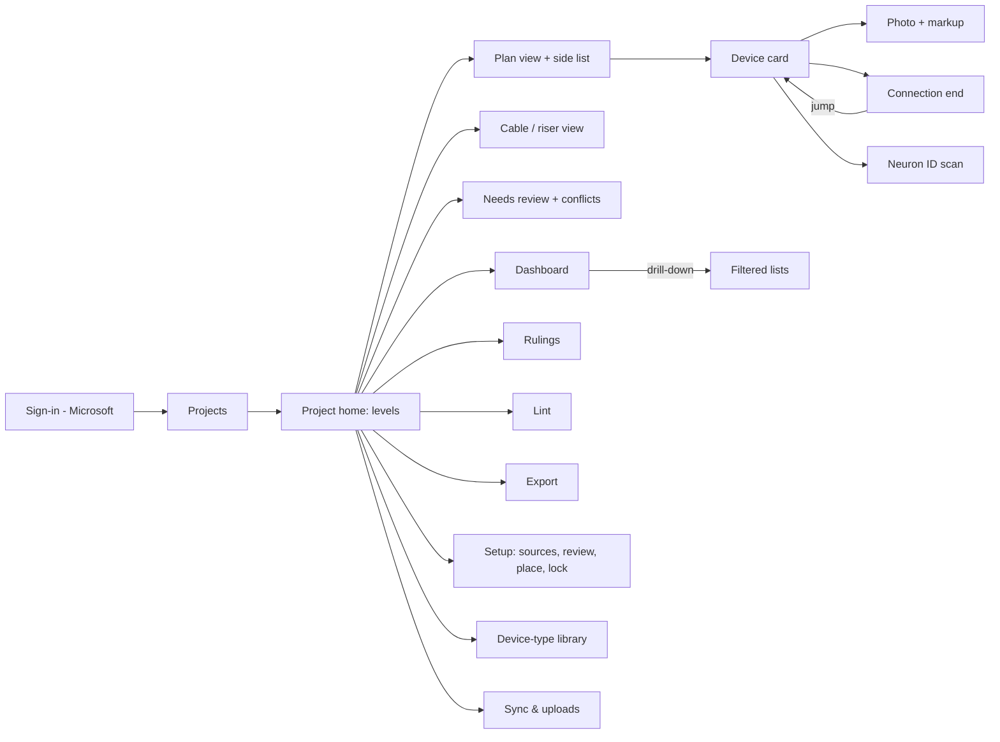

# Survey iPad App — Phase 3 (Gate 3): UX wireframes

Date 2026-10-09. Inputs: `Fable_Prompt_Survey_iPad_App.md`, `Lighting_Control_Survey_Master_B2-06_4.xlsx`, `Level_06M_-_Lighting_Composite_vector.pdf` (rasterised and text-scanned for the plan-view screens), project docs Gate 1, Phase 1, Phase 2. Web search off. Wireframes are ASCII at iPad landscape proportions (11"/13" Air and Pro per G2-2); exact spacing is for Phase 4. Items beyond the attachments and your answers are marked **(proposal)**.

New facts from the 06M composite used below: two grid systems on one sheet (Centennial Tower orthogonal; Walter Tower rotated ≈30°), so grid calibration needs a *grid set* picker and the "WT Grid" prefix from §7.4 of Phase 2 applies per set; the title strip says "magenta = source sheet boundaries (layer toggle)", so the viewer gets a boundary-layer toggle; text layer carries `CT06LCPA/B`, `EBDK`, `UFMP8`, rack component tags (`P-ACP`, `P-SPM-E`, `P-REP`) and room codes (`XX06M-1E05`) → panel pre-placement proposals are feasible on this sheet.

## 1. Gate 2 answers → decisions

| # | Your answer | Decision / consequence |
|---|---|---|
| G2-1 | sure | **D34** E1–E12 stand. A3 closed. |
| G2-2 | newer iPad Airs and Pros | **D35** Target iPadOS 17+, M-series/A14+; the tile-pyramid fallback drops to a Phase 4 risk item, not an MVP milestone. A5 closed. |
| G2-3 | each device generates its own Neuron ID need; the sheet compiles them into one item per floor listing all devices | **D36** `device.neuron_id` null = an open *need*. One punch item per numbering group ("Missing all Device Neuron IDs", Information, EC, `sort_last`) whose Notes list the device IDs still missing, regenerated by the engine as IDs are captured **(proposal: auto-close when the list is empty — confirm G3-1)**. |
| G2-4 | sure | **D37** A6/A7 confirmed: first-arrived value is official with an "in review" badge; one person's own iPads never review against each other. |
| G2-5 | keep high res to zoom; reduce size slightly by converting | **D38** Full-resolution JPEG at quality ≈0.9, HEIC not kept; thumbnails 320 px. A8 closed. |
| G2-6 | not understood | Restated in §13 (G3-2). |
| G2-7 | yes | **D39** Everyone signs in with a Microsoft account in your tenant; no guest flow in MVP. A9 closed. |
| G2-8 | "changelog is app only. Not exported." | Read as: the **who** stays in the app; the Change Log tab is still exported without a who column (the prompt's Must). **Confirm G3-3** — if you meant the whole tab is dropped from the export, say so. |
| G2-9 | not understood | Restated in §13 (G3-4). |
| G2-10 | only in the PDF | **D40** No full-size originals for the 76 seed photos; the import keeps the 320×240 images and marks them `seed-thumbnail-only`. Field photos taken in the app are full-size from day one. |
| G2-11 | none exists | **D41** The floor PDF layout is designed here (§11.3) rather than copied. |
| G2-12 | UHCI is the master | **D42** Level 04 partition sensing = one device `UHCI-WM` (Category Sensor) with accessories for the through-beam parts (AD-C18 etc.), per D27. |
| G2-13 | not determined | Hosting stays open for Phase 4 (prices verified then). |
| Overall | not every device type is in this project; need to add device types with default connections (and optional ones) and optional accessories after project creation | **D43** The device-type library becomes an in-app editor (§10): a type has a model, category, default cables, *optional* cables and *optional* accessories; new types and cables are drafts until you accept them, which keeps the prompt's "ask me before adding to the library" as an in-app gate rather than a conversation. |

## 2. Navigation and shared conventions

### 2.1 Map



Layout rule (Fieldwire pattern, 1d): the plan or main list fills the left ~62 %; a side panel (list, card, or editor) fills the right ~38 % and never navigates away from the plan. Full-screen pages (setup, dashboard, rulings, export) use a left sidebar of sections.

### 2.2 Status colours and pin glyphs

| Status | Colour (your code) | Pin glyph |
|---|---|---|
| Complete | green | ● |
| Installed, untested | purple | ● |
| Issue | red | ● with "!" |
| Not installed | red, hollow | ○ "NI" |
| No access | yellow | ● "?" |
| Not started (connections only) | grey | — |
| Field addition (origin) | any status + "+" corner mark | |
| Not on sheet / never found | grey × | ⊗ |

Colour is never the only signal (letter/shape too). Category shows as the pin shape: square = panel/rack/EBDK/NSPS, circle = station, diamond = sensor, triangle = touchscreen **(proposal)**.

### 2.3 Record badges (used on every list row and card header)

| Badge | Meaning | Source |
|---|---|---|
| `NEW` | Created on this iPad, display number not yet assigned by the server | D25 |
| `↑3` | Record has 3 pending (unsynced) ops | §4.2 |
| `IN REVIEW` | An open review item on one of its fields; the field shows the official value with the badge | D37 |
| `DRAFT` | Rule proposal not yet accepted, or setup draft | §6.1 |
| `DELETED` | Soft-deleted; visible only with the "show deleted" filter | §3.1 |
| `📷 2 waiting` | Photo bytes not yet uploaded | §4.5 |
| `⚑ rule R3a` | Generated by a rule; tap shows the rule text | §6.1 |

### 2.4 Global status bar (top right of every screen)

```
[ ● Offline — 14 edits, 6 photos waiting ]   or   [ ● Synced 20:04 — 0 waiting ]   or   [ ↻ Syncing 12/14 … ]
```
Tap opens the Sync screen (§12). Red variant: "Sign-in needed to sync" (token expired, iPad online).

## 3. Project setup

### 3.1 Create project

```
┌──────────────────────────────────────────────────────────────────────────────────────────┐
│ ◀ Projects        New project                                        [● Synced 20:04]     │
├──────────────────────┬───────────────────────────────────────────────────────────────────┤
│ 1 Project   ●        │ Name        [Houston Methodist Centennial Tower            ]       │
│ 2 Levels             │ Site        [Houston, TX                                   ]       │
│ 3 Sources            │ Parties     EC [            ]  ETC [ETC Field Service ]  GC [   ]  │
│ 4 Review drafts      │ Copy from   [Centennial Tower (2026) ▾]                           │
│ 5 Place devices      │             ☑ Vocabulary  ☑ Device-type library  ☑ Standing rulings│
│ 6 Lock baseline      │             ☐ Placeholders                                          │
│                      │ Export title [ETC Lighting Controls Survey]                        │
│                      │ Disclaimer   [Based on submittal drawings rev F …          ]       │
│                      │                                                   [Next: Levels ▸] │
└──────────────────────┴───────────────────────────────────────────────────────────────────┘
```

Levels step:

```
│ Levels  (drag to reorder)                                  [+ Add level] [Add range…]     │
│ ┌────┬──────┬───────────┬─────────────────┬──────────┬────────────────────┐              │
│ │ #  │ Code │ In scope  │ Numbering group │ Split of │ Display sheet      │              │
│ ├────┼──────┼───────────┼─────────────────┼──────────┼────────────────────┤              │
│ │ 1  │ B2   │ ☑         │ B2              │          │ (none yet)         │              │
│ │ 7  │ 06   │ ☑         │ 06 ◀ shared     │          │                    │              │
│ │ 8  │ 06M  │ ☑         │ 06 ◀ shared     │ 06       │ Level_06M_…pdf     │              │
│ │ 9  │ 09   │ ☐ far end │ 09              │          │                    │              │
│ └────┴──────┴───────────┴─────────────────┴──────────┴────────────────────┘              │
```
"Add range…" creates 09–28 as out-of-scope levels from the riser (R2f far ends); toggling In scope later is one tap.

### 3.2 Sources (upload)

```
┌──────────────────────┬───────────────────────────────────────────────────────────────────┐
│ 3 Sources   ●        │ BOM            [BOM.pdf  6 pp, text ✓ p.3 OCR]      job 15076538  │
│                      │                [+ Add BOM file]  (4 jobs seen)                     │
│                      │ Riser          [riser.pdf  2 sheets: 001 text ✓, 002 OCR ⚠]        │
│                      │ Floor plans    per level:                                          │
│                      │  ┌──────┬──────────────────────────┬──────────────────────────┐    │
│                      │  │ Lvl  │ Display sheet (composite)│ Source sheets             │    │
│                      │  ├──────┼──────────────────────────┼──────────────────────────┤    │
│                      │  │ 06M  │ Level_06M_Composite.pdf  │ Ef.106.5.A/B/D/E (4)     │    │
│                      │  │      │ grid: auto ✓ 2 sets      │                          │    │
│                      │  │ 06   │ [Choose…]                │ [Choose…]                │    │
│                      │  └──────┴──────────────────────────┴──────────────────────────┘    │
│                      │ Seed import    [Master .xlsx] → column mapping (pre-matched) ▸     │
│                      │                                                                     │
│                      │ Extraction job   ▰▰▰▰▰▱▱ 71 %  "Riser 001: endpoints (Claude)"      │
│                      │ Needs online + sign-in. Runs on the server; you can leave.         │
│                      │                                                   [Run extraction] │
└──────────────────────┴───────────────────────────────────────────────────────────────────┘
```

Grid calibration sheet (opens from "grid: auto ✓"):

```
│ Grid calibration — 06M                                                                   │
│ Grid set  [Centennial ▾] [Walter Tower ▾] [+ set]      Prefix for Drawing Position: [WT ] │
│ ┌─────────────────────────── plan thumbnail ───────────────────────────┐                 │
│ │  A  B  C  D  E  F  G  H  (bubbles detected: 8 cols, 24 rows, 3 frac)│  Residual 1.2 pt │
│ │  …                               ╱ WT grid rotated 30°  ╱           │  ● auto          │
│ └──────────────────────────────────────────────────────────────────────┘                 │
│ If wrong: tap three bubbles on the plan to recalibrate.      [Test: tap a point → "C-9"] │
```

### 3.3 Review drafts against sources (per level, D11)

```
┌──────────────────────────────────────────────────────────────────────────────────────────┐
│ 4 Review drafts    Level [06M ▾]   Devices 11 · Cables 24 · Needs review 5     [Accept all ✓ ≥0.9] │
├────────────────────────────────────────────────┬─────────────────────────────────────────┤
│ Filter: [All][Needs review 5][Conflict 2][Rejected]   Sort: confidence ▾                  │
│ ┌─┬──────┬────────────┬─────────┬────┬────┬────┐│  Draft device  ⚠ conflict                │
│ │☐│ Lvl  │ Model      │ Cat     │Qty │Conf│Src ││  Model   ○ P-DOC-C-LR  (riser, master)   │
│ ├─┼──────┼────────────┼─────────┼────┼────┼────┤│          ○ P-DOC-C-SR  (BOM 15084074 L12) │
│ │☐│ 06M  │ CT06LCPA   │Relay pnl│ 1  │0.96│R+B ││          → pick one; nothing auto (D28)   │
│ │☐│ 06M  │ CT06LCPB   │Relay pnl│ 1  │0.96│R+B ││  Category Sensor   Type  Ceiling, large   │
│ │☐│ 06M  │ EBDK       │EBDK     │ 2  │0.91│R+B ││  Qty     13  (BOM 13 · riser 13 · master 9 ⚠)│
│ │☐│ 06M  │ Equip rack │Eq rack  │ 1  │0.88│R:L5││  Level   06M  basis: riser band            │
│ │☐│ 06M  │ UFMP8      │Foundry  │ 1  │0.93│R+B ││  Accessories  ERP-FT-LVD ×2 · ERP-RTO ×1   │
│ │▶│ 03   │ P-DOC-C-?  │Sensor   │13 ⚠│0.62│B⚠ ││  ┌─ source crops ──────────────────────┐  │
│ └─┴──────┴────────────┴─────────┴────┴────┴────┘│  │ BOM p.4 line 112  │ riser 001 band 03 │  │
│ Mismatch list (this level)                     │  │ [crop image]       │ [crop image]      │  │
│  • BOM qty 13 ≠ master 9 (L03 ceiling sensors) │  └──────────────────────────────────────┘  │
│  • Riser device not in BOM: P-TS7-E (L01)      │  [Accept] [Edit…] [Reject] [Promote line…] │
│  • Rack at BOM "Level 5" → alias 06M (vocab)   │  Excluded BOM lines (14) ▸ promotable (D12) │
└────────────────────────────────────────────────┴─────────────────────────────────────────┘
```

Cables tab is the same layout with columns Code · From · To · To-level · Qty · Conf · Src, and the right panel shows the riser band crop with the bubble highlighted plus From/To pickers (device or placeholder from the vocabulary, "+ new placeholder"). "Riser verification" (D6) = the reviewer taps **Confirm endpoint** per cable; unconfirmed cables show ⚑ in the cable view.

### 3.4 Place devices from the unplaced list

```
┌──────────────────────────────────────────────────────────────────────────────────────────┐
│ 5 Place devices — 06M        Placed 7 of 11       [Boundaries ☑] [Grid ☑]   [Done placing]│
├────────────────────────────────────────────────────────┬─────────────────────────────────┤
│                                                        │ Unplaced (4)    [Level ▾][Type ▾]│
│     plan (pan / pinch zoom)                            │ ┌──────────────────────────────┐ │
│                                                        │ │ ▣ EBDK          ×1 (06M)     │ │
│   ▣ CT06LCPA  ← proposed from text tag (dashed)        │ │ ▣ UFMP8         ×1 (06M)     │ │
│   ▣ CT06LCPB  ← proposed                               │ │ ○ PI1002        pool ×120    │ │
│       [✓ keep] [move]                                  │ │ ◇ P-DOC-C-LR    pool ×17 (L1)│ │
│                                                        │ └──────────────────────────────┘ │
│         ● tap here to drop the selected item           │ Selected: EBDK                   │
│                                                        │  Tap the plan, or drag the row.  │
│                                                        │  [Flag: not on this sheet ⊗]     │
│                                                        │ ─────────────────────────────── │
│                                                        │ After tap → confirm:             │
│                                                        │  ID   [06M-] [04 ▾]  (next free) │
│                                                        │  or tag [S__] for stations/sensors│
│                                                        │  Drawing Position  [Grid C / 9 ]  │
│                                                        │  Room  [XX06M-1E05 Elec Rm ▾]     │
│                                                        │  [Place ✓]        [Cancel]        │
└────────────────────────────────────────────────────────┴─────────────────────────────────┘
```
Placing a pooled item (PI1002 ×120) sets its level from the sheet and decrements the pool. Panels pre-placed from text tags are dashed until confirmed (§7.4). Progress shows per level on the Levels table ("06M 11/11 placed, 0 flagged").

### 3.5 Lock baseline (per level)

```
│ 6 Lock baseline                                                                           │
│ ┌──────┬─────────┬─────────┬──────────┬────────────┬────────────────┬──────────────────┐  │
│ │ Lvl  │ Drafts  │ Placed  │ Flagged  │ Cables ⚑   │ Needs review   │                  │  │
│ ├──────┼─────────┼─────────┼──────────┼────────────┼────────────────┼──────────────────┤  │
│ │ 06M  │ 11/11 ✓ │ 11/11 ✓ │ 0        │ 0 unconf.  │ 0              │ [Lock 06M]       │  │
│ │ 03   │ 34/36   │ 30/36   │ 1        │ 2 unconf.  │ 3              │ Lock (warns) ⚠   │  │
│ │ 09   │ out of scope — far-end only                                 │ —                │  │
│ └──────┴─────────┴─────────┴──────────┴────────────┴────────────────┴──────────────────┘  │
│ Lock dialog: "Lock 03 with 2 unreviewed drafts and 1 flagged device? Change-logging starts │
│ now; drafts stay in Needs review."  [Lock anyway] [Cancel]                                 │
```
A locked level shows a lock icon on Project home; "Unlock" is allowed and logged (**proposal**).

## 4. The field loop

### 4.1 Project home (works offline)

```
┌──────────────────────────────────────────────────────────────────────────────────────────┐
│ Centennial Tower                 [Search ID / tag / room …]        [● Offline — 14, 📷6]   │
├──────────────────────┬───────────────────────────────────────────────────────────────────┤
│ ▸ Levels             │ Assigned to me ☑     Show all ☐                                    │
│   Cable / riser      │ ┌─────┬───────┬───────────┬──────────┬─────────┬────────┬───────┐  │
│   Needs review (7)   │ │ Lvl │ State │ Devices   │ Issue/NI │ Open    │ Review │ Cache │  │
│   Dashboard          │ ├─────┼───────┼───────────┼──────────┼─────────┼────────┼───────┤  │
│   Rulings            │ │ 06M │ 🔒 ▲  │ 4         │ 1 / 0    │ 15      │ 2      │ ✓ 3MB │  │
│   Lint (12)          │ │ 06  │ 🔒 ▲  │ 14        │ 2 / 6    │ 3       │ 0      │ ✓     │  │
│   Export             │ │ 03  │ 🔒    │ 36        │ 9 / 12   │ 31      │ 3      │ ✓     │  │
│   Setup              │ │ 07  │ setup │ 0 / 40    │ —        │ —       │ 5      │ ⬇ 41MB│  │
│   Library            │ └─────┴───────┴───────────┴──────────┴─────────┴────────┴───────┘  │
│   Sync & uploads     │ ▲ = surveying (as-found ops exist)   ⬇ = plan not cached yet        │
│   Me: Landry · sign out │                                                                 │
└──────────────────────┴───────────────────────────────────────────────────────────────────┘
```

### 4.2 Plan view with pins and side list

```
┌──────────────────────────────────────────────────────────────────────────────────────────┐
│ ◀ 06M   [Cat ▾][Status ▾][Owner ▾][Open punch ☐][Mine ☐]  [Search]   [Layers ▾] [● Offline]│
├────────────────────────────────────────────────────────┬─────────────────────────────────┤
│  A      B      C      D      E      F      G      H    │ [Devices 4][Conns 24][Punch 15] │
│ 1 ┄┄┄┄┄┄┄┄┄┄┄┄┄┄┄┄┄┄┄┄┄┄┄┄┄┄┄┄┄┄┄┄┄┄┄┄┄┄┄┄┄┄┄┄┄┄┄┄┄┄┄  │ [Parts 13]                     │
│ 2           ▣06M-01 CT06LCPB  (purple)                 │ ┌─────────────────────────────┐ │
│ 3           ▣06M-02 CT06LCPA  (red !)                  │ │ 06M-01 CT06LCPB  Inst,untest│ │
│ 4           ▣06M-03 EBDK      (purple)                 │ │ 06M-02 CT06LCPA  Issue ↑1   │ │
│ 5           ▣06M-04 Equip rack(purple) ↑2              │ │ 06M-03 EBDK      Inst,untest│ │
│ 6                                                      │ │ 06M-04 Equipment rack ↑2    │ │
│ 7      magenta source-sheet boundary (toggle)          │ │ NEW  06M-S1 PI1002  No access│ │
│ 8                                                      │ └─────────────────────────────┘ │
│ …        ╱ Walter Tower grid (WT) ╱                    │ Tap a row → highlights its pin;  │
│                                                        │ tap a pin → highlights the row   │
│  (long-press empty space → Add device / Note / Photo)  │ and opens the card (§4.3).       │
│                                             [⌖ fit] [+]│ Legend: ● purple ● red ○NI ● yel │
└────────────────────────────────────────────────────────┴─────────────────────────────────┘
```
Layers: pins · labels · boundaries · my markup (PencilKit ink on the sheet, stored per user) · photos-as-pins. Filters persist per level. Pins cluster at low zoom with a count.

### 4.3 Device card (side panel, scrolls; sections collapsible)

```
┌─────────────────────────────────────────────────────┐
│ 06M-02  CT06LCPA Echo relay panel      ↑1  [⋯]  [×] │
│ Relay panel · Grid C / 3 · XX06M-1E05 Elec Rm        │
│ ┌─ Status ──────────────────────────────────────────┐│
│ │ [Complete] [Installed, untested] [■ Issue]        ││
│ │ [Not installed] [No access]                       ││
│ │ ⚑ R1: 2 open items → Issue (suggested)            ││
│ └───────────────────────────────────────────────────┘│
│ Notes   [Missing ERP-FT-LVD card (1 of 2) …        ] │
│         vocabulary: [Not run][Run, not terminated]   │
│         [Lands in ERP; needs to be run down…][more ▾]│
│ Accessories  ERP-FT-LVD  expected 2  found [1 ▾] ⚑E5 │
│              ERP-RTO     expected 1  found [1 ▾]     │
│ Neuron ID  [—  not captured]  [Scan ▸]  [Type…]      │
│ ┌─ Photos (3) ─ 📷 1 waiting ───────────────────────┐│
│ │ [img][img][img]  [📷 Camera] [🖼 Library]          ││
│ └───────────────────────────────────────────────────┘│
│ ┌─ Connections (5) ─────────────────────────────────┐│
│ │ C-03  X  → Level 03 UFMP4s        Issue   [jump ▸]││
│ │       note: Run, not terminated; no term kit      ││
│ │ C-07  P  → EBDK panic wire         Inst,unt (1 row)││
│ │ C-08  0-10V → Fixtures             Issue ⚑E5      ││
│ │ C-15  U  → Stations & sensors      Not inst       ││
│ │ NEW   N  → Level 09 (not in scope) Not started    ││
│ └───────────────────────────────────────────────────┘│
│ ┌─ Punch items (2) + proposals (2) ─────────────────┐│
│ │ #4  Land 0-10V control wiring  Wiring EC  Open    ││
│ │ #9  Waiting on DMX Termination Kits  Missing part ││
│ │ DRAFT ⚑R3a  Run DMX to Level 03 UFMP4s  Cable not ││
│ │   run · EC   [Accept][Edit][Reject]  why? ▸       ││
│ │ DRAFT ⚑R4b  DMX termination kit - Level 03 run    ││
│ │   part · EC · Needed  [Accept][Edit][Reject]      ││
│ └───────────────────────────────────────────────────┘│
│ Missing parts (1)   #6 ERP-FT-LVD ×1  Needed  src #4 │
│ Quick actions  [Spot-check fixed E6] [Non-ETC E7]    │
│                [Relocated E9] [Not found on site]    │
│ ┌─ History ─────────────────────────────────────────┐│
│ │ 10/09 14:02 Landry  Status  Installed,untested→Issue│
│ │   Field survey · "LVD card missing"               ││
│ │ 10/09 13:50 Alex    Notes   (blank)→Missing ERP…  ││
│ │ 10/08 09:12 import  (row added)  Field survey     ││
│ └───────────────────────────────────────────────────┘│
└─────────────────────────────────────────────────────┘
```
"why?" on a draft shows the rule text and the inputs that fired it. Edits commit on tap (no Save button); each tap is one op. `[⋯]` = delete (asks for reason), duplicate, move pin.

### 4.4 Photo capture and markup

```
┌──────────────────────────────────────────────────────────────────────────────────────────┐
│ ◀ 06M-02     Photo  NEW                                              [Save]              │
├────────────────────────────────────────────────────────┬─────────────────────────────────┤
│                                                        │ Subject   [ERP interior      ]  │
│            full image (pinch zoom)                     │ Caption   [Missing LVD card  ]  │
│            PencilKit layer over it                     │  vocab: [Empty box on wall.]    │
│                                                        │         [Wire nuts, not Wagos]  │
│                                                        │ Linked    06M-02 · punch #4 ▾   │
│                                                        │ Location  XX06M-1E05 (from dev) │
│                                                        │ Tools  ✎ pen  ○ circle  → arrow │
│                                                        │        T text  ⌫ undo  colour   │
│                                                        │ Original kept; markup separate. │
│                                                        │ Upload: 📷 waiting (offline)     │
└────────────────────────────────────────────────────────┴─────────────────────────────────┘
```
Camera button on the card opens the camera straight away; caption sheet appears after the shutter so a photo is two taps.

### 4.5 Connection end editor (and jump)

```
┌─────────────────────────────────────────────────────┐
│ C-03  X (DMX)   Qty 1          both ends ▾     [×]  │
│ ┌─ This end: 06M-02 CT06LCPA (Level 06M) ──────────┐│
│ │ Status [Complete][Inst,untested][■ Issue][NI][NA]││
│ │ Note   [Run, not terminated; no term kit        ]││
│ │        vocab: [Not run][Run, not terminated]     ││
│ │ Surveyed by Landry 10/09 14:05   source: surveyed││
│ └──────────────────────────────────────────────────┘│
│ ┌─ Other end: 03-05 UFMP4 (Level 03) ──────────────┐│
│ │ Status  Issue (copied from this end ⚑R2f)        ││
│ │ Note    (per Level 06M)                          ││
│ │ [Jump to 03-05 ▸]  opens Level 03 plan, pin lit  ││
│ └──────────────────────────────────────────────────┘│
│ Riser says To: "DMX TO LEVEL 03 UFMP"  ✓ matches    │
│ To text  [DMX to Level 03 UFMP4s]  (generated, D32) │
│ ⚑ checks: none                                      │
└─────────────────────────────────────────────────────┘
```
Jump across floors pushes the other level's plan; a back-chevron returns to this card. If that level's plan isn't cached, the list view opens instead with "plan not downloaded".

### 4.6 Long-press on the plan

```
 ┌────────────────────────────┐
 │ + Device (field addition)  │ → type picker from library → ID assigned (level + next / tag) → card
 │ + Note here                │
 │ + Photo here               │
 │ ✎ Markup (ink)             │
 └────────────────────────────┘
```
Field additions get origin `field_addition`, a "+" pin mark, and appear in the dashboard's "found on site, not in baseline" count.

### 4.7 Neuron ID scan

```
┌──────────────────────────────────────────────────────────────────────────────────────────┐
│ ◀ 06M-02   Scan Neuron ID                                                                 │
│ ┌───────────── live camera ─────────────┐  Found:  0 0 A 1 B 2 C 3 D 4 E 5   (3 frames ✓) │
│ │   [label crop highlighted]            │  ⚠ check 0/O at position 1                      │
│ └───────────────────────────────────────┘  Duplicate check: none in project                │
│                                            [Use this ID]  [Type instead]  [Retake]         │
│  Saves the label crop as evidence (method: scan)                                           │
└──────────────────────────────────────────────────────────────────────────────────────────┘
```
Saving removes the device from the floor's Neuron ID item Notes list (D36).

## 5. Cable / riser view

```
┌──────────────────────────────────────────────────────────────────────────────────────────┐
│ Cable / riser     Group by [Vertical ▾] [Level][Code]   Filter [Code ▾][Status ▾][Checks ☑] │
├──────────────────────────────────────────────────────┬───────────────────────────────────┤
│ ▾ Vertical: Rack 06M → DMX risers (X)   7 cables     │ Selected C-03                     │
│  ┌──────┬─────┬────────────┬──────────┬────────────┐ │ (same end editor as §4.5, both    │
│  │ Code │ A   │ A status   │ B        │ B status   │ │  ends stacked, riser crop below)  │
│  ├──────┼─────┼────────────┼──────────┼────────────┤ │ ┌───────────────────────────────┐ │
│  │ X    │06M-02 C-03│Issue │03-05 C-13│Issue (copied)│ │ riser 001 band 06 [crop]       │ │
│  │ X    │06M-02 C-04│Issue │04-?? —   │⚠ missing end │ │ bubble X highlighted            │ │
│  │ X    │06M-02 C-05│NI    │09 — n/s  │Not started   │ └───────────────────────────────┘ │
│  └──────┴─────┴────────────┴──────────┴────────────┘ │ Checks on this cable:             │
│ ▾ Vertical: Fiber (F) rack 01 ↔ rack 06M   3         │  ⚠ To ≠ riser label (R2b)         │
│ ▾ Vertical: Network (N) 28-port switch     16        │  ⚠ end statuses incompatible       │
│ ▾ Same-floor: Unison buses (U)  per level  14        │ [Open Needs review item ▸]        │
│ ▾ Single-row: P · 0-10V · 120V             28        │                                   │
├──────────────────────────────────────────────────────┴───────────────────────────────────┤
│ Consistency checks (project)  missing far end 4 · code mismatch 0 · status mismatch 3 ·   │
│ To ≠ riser 2 · unconfirmed riser endpoint 2 · Not started ends on in-scope level 1        │
└──────────────────────────────────────────────────────────────────────────────────────────┘
```
"Vertical" = the riser run grouping (origin device/rack output + code); derived from `riser_ref` and the rack output label, editable. A riser mini-map (levels as rows, verticals as columns, cells coloured by the worse end status) sits behind the [Riser map] toggle **(proposal)**.

## 6. Needs review and conflict review

```
┌──────────────────────────────────────────────────────────────────────────────────────────┐
│ Needs review (7)   [All][Sync conflict 2][Extraction 3][Source conflict 1][Import pair 1] │
│                    Level [All ▾]   Sort [oldest ▾]                                        │
├──────────────────────────────────────────────┬───────────────────────────────────────────┤
│ ● 06M-02 Notes · sync conflict · 10/09       │ Sync conflict — 06M-02 CT06LCPA · Notes    │
│ ● 03 C-13 Status · sync conflict · 10/09     │ ┌─────────────────────┬───────────────────┐│
│ ● L03 P-DOC-C-? qty 13 vs 9 · source conflict│ │ A  (official now)   │ B                 ││
│ ● riser 001 band 04 X endpoint 0.58 · extract│ │ Landry · 10/09 14:02│ Alex · 10/09 14:07││
│ ● B1 C-02 ↔ B2 C-01 pairing 0.7 · import pair│ │ iPad "Field 1"      │ iPad "Field 2"    ││
│ …                                            │ │ "Missing ERP-FT-LVD │ "LVD card present,││
│                                              │ │  card (1 of 2)"     │  not seated"      ││
│                                              │ └─────────────────────┴───────────────────┘│
│                                              │ was: (blank)      field head before both   │
│                                              │ [Choose A] [Choose B] [Combine ▸]          │
│                                              │ Combine → editor pre-filled "A; B", A first │
│                                              │ Reason [Review: chose … (auto-filled)     ] │
│                                              │ Context: device card preview ▸  · photos ▸ │
│                                              │ Flag: ⚑ ruling lost to field edit (if any) │
└──────────────────────────────────────────────┴───────────────────────────────────────────┘
```
Pin-position conflicts show both pins on the plan (A solid, B dashed) with "Choose A/B" under the plan. Field-group conflicts (Tracking status + Date closed) show both pairs. Resolving emits one Reconcile op and closes the item; the `IN REVIEW` badge clears everywhere on the next pull.

Extraction and source-conflict items open the §3.3 right panel inline; import-pair items show the two candidate ends with their verbatim From/To text and [Pair] [Not a pair → placeholder far end].

## 7. Dashboard (Summary counts, charts, drill-down — D17)

```
┌──────────────────────────────────────────────────────────────────────────────────────────┐
│ Dashboard   Levels [All ▾]   Owner [All ▾]   as of sync 20:04 (local data)                │
├──────────────────────────────────────────────┬───────────────────────────────────────────┤
│ Device status by floor                       │ ▇▇▇▇▇▇▇▇ stacked bar per level            │
│ ┌────┬──────┬─────┬────┬────┬────┬─────┐     │ (Inst,untested · Issue · NI · No access · │
│ │Flr │Inst,u│Issue│ NI │ NA │Cmpl│Total│     │  Complete)                                 │
│ ├────┼──────┼─────┼────┼────┼────┼─────┤     │                                            │
│ │ B2 │  2   │  1  │  2 │  0 │ 0  │  5  │ ◂tap│                                            │
│ │ 01 │ 12   │  9  │ 13 │  2 │ 0  │ 36  │     │                                            │
│ │ … │                                  │     │                                            │
│ │ All│ 70   │ 50  │ 77 │ 13 │ 0  │ 210 │     │                                            │
│ └────┴──────┴─────┴────┴────┴────┴─────┘     │                                            │
│ Outstanding items by floor (Open/In prog/Closed) + chart                                  │
│ Outstanding by owner (EC/ETC/EC-ETC) + chart                                              │
│ Missing parts by floor (Needed/Ordered/On site/Installed) + chart                         │
│ As-found: field additions 3 · never found 2 · Neuron IDs captured 0/210                   │
│ Readiness: 06M surveying · 03 surveying · 07 setup (5 review)                             │
└──────────────────────────────────────────────┴───────────────────────────────────────────┘
```
Drill-down: tapping any count opens the matching list with filters pre-set (e.g. Level 01 · Status Issue), from which a row opens the card on its plan. The same four tables are what the export's Summary tab produces, so numbers match the workbook exactly.

Search (global, from Project home): results grouped Devices · Connections · Punch · Parts · Photos, matched on ID, tag, room, item text, notes, Neuron ID (FTS).

## 8. Rulings

```
┌──────────────────────────────────────────────────────────────────────────────────────────┐
│ Rulings (7 standing · 12 applied)                                           [+ New ruling]│
├──────────────────────────────────────────────┬───────────────────────────────────────────┤
│ ● 0-10V rows read "Fixtures"   standing · 9 ops│ New ruling                                │
│ ● To field follows the riser   standing · 9    │ Reason  [0-10V rows read Fixtures        ] │
│ ● Owner ETC/EC → EC/ETC        rename · 6      │ Scope   Levels [All ▾]                     │
│ …                                              │ Where   Entity [Connection end ▾]          │
│                                                │         [Cable][=][0-10V]  AND             │
│                                                │         [To][≠][Fixtures]        [+ cond] │
│                                                │ Action  [Set field ▾] To = [Fixtures]      │
│                                                │         (also: rename phrase · append note │
│                                                │          · generate item)                  │
│                                                │ ☑ Standing: propose on future matches      │
│                                                │                              [Preview ▸]  │
└──────────────────────────────────────────────┴───────────────────────────────────────────┘
Preview:
│ 9 changes on 6 levels                                     [Untick to skip]  [Apply 9] [Back]│
│ ┌─┬─────┬──────┬───────┬──────────────────────┬──────────┐                                │
│ │☑│ Lvl │ Ref  │ Field │ Was                  │ Now      │                                │
│ ├─┼─────┼──────┼───────┼──────────────────────┼──────────┤                                │
│ │☑│ B1  │ C-04 │ To    │ Control wiring       │ Fixtures │                                │
│ │☑│ 01  │ C-09 │ To    │ 0-10v to fixtures    │ Fixtures │                                │
│ │☐│ 03  │ C-11 │ To    │ Fixtures (east wing) │ Fixtures │ ← skipped, keeps qualifier     │
│ └─┴─────┴──────┴───────┴──────────────────────┴──────────┘                                │
│ Each ticked row becomes one Change Log line: Change = Ruling, Reason = the ruling text.    │
```
Multi-select in any list → "Apply as ruling…" opens the same editor pre-filled with the selected records as the scope (1d pattern).

## 9. Lint view

```
┌──────────────────────────────────────────────────────────────────────────────────────────┐
│ Lint (12 open · 3 dismissed)   Level [All ▾]   Group by [Check ▾]                         │
├──────────────────────────────────────────────┬───────────────────────────────────────────┤
│ ▾ Issue device without open punch item (4)   │ 03-07 PI1104 · Issue · no open items       │
│    03-07 · 04-S3 · 06-02 · 01-D4             │ Suggested: add item from vocabulary        │
│ ▾ NSPS/rack without 120V row (1)             │ [Open card ▸] [Add punch item…] [Dismiss…] │
│ ▾ Neuron ID item not last / missing (0)      │ Dismiss asks for a reason; dismissed items │
│ ▾ Value outside vocabulary (5)               │ reappear if inputs change.                 │
│    "ETC/EC" ×2 → [Fix all via ruling ▸]      │                                            │
│ ▾ Cable with missing far end (2)             │                                            │
│ ▾ Level locked with unreviewed drafts (1)    │                                            │
└──────────────────────────────────────────────┴───────────────────────────────────────────┘
```

## 10. Device-type library editor (D43, new)

```
┌──────────────────────────────────────────────────────────────────────────────────────────┐
│ Device-type library (17 types · 2 drafts)                      [+ New type] [Copy from…] │
├──────────────────────────────────────────────┬───────────────────────────────────────────┤
│ Relay panel  CTxxLCPA/B (ERP-FT-241P/481P)   │ Type: P-NSPS-D-KIT        Category NSPS   │
│ EBDK                                         │ Aliases (BOM) [P-NSPS-D-KIT, P-NSPS-D  ]  │
│ Foundry panel  UFMP4 · UFMP8                 │ ID scheme  ○ level-number  ● level-tag(S/D)│
│ NSPS  P-NSPS-D-KIT                 ◀         │ Default cables (always generated)          │
│ Equipment rack 18U                           │  ┌──────┬──────────────┬───────────────┐   │
│ Station  PI1002 · PI1004 · PI1104            │  │ Code │ From / To    │ Rows          │   │
│ Sensor  P-DOC-C-LR · -SR · -W · -SM2 · P-LS  │  ├──────┼──────────────┼───────────────┤   │
│ Sensor  UHCI-WM (partition)                  │  │ 120V │ 120v Power → │ 1 single_row  │   │
│ Touchscreen  P-TS7-E                         │  │      │ P-NSPS-D PS  │               │   │
│ DRAFT  P-TS18-E  (added by Alex 10/09) ⚑     │  │ U    │ Stations &   │ 2 ends, qty — │   │
│ DRAFT  UFMP8 → fixture DMX outputs ⚑         │  │      │ sensors ↔    │               │   │
│                                              │  └──────┴──────────────┴───────────────┘   │
│                                              │ Optional cables (offered on the card, not  │
│                                              │ auto-generated)  [N → switch] [+ add]      │
│                                              │ Optional accessories  [+ add]              │
│                                              │  ERP-FT-LVD exp. from BOM · ERP-RTO        │
│                                              │ Rules that reference this type: R2d, R2e   │
│                                              │ State: ● Accepted   [Accept draft] [Reject]│
└──────────────────────────────────────────────┴───────────────────────────────────────────┘
```
Anyone can add a type or cable as a draft; drafts are usable on the plan immediately (so a surveyor isn't blocked) and are flagged until you accept them. "Optional cables" appear on the device card as a greyed "+ add N → switch" row. Accepting a type with default cables raises proposals for existing devices of that type (not automatic edits).

## 11. Export

### 11.1 Export screen

```
┌──────────────────────────────────────────────────────────────────────────────────────────┐
│ Export                                        needs online + sign-in     [● Synced 20:04] │
├──────────────────────┬───────────────────────────────────────────────────────────────────┤
│ Master workbook      │ Levels  [All in scope ▾]  (title row 2 → "Levels B2-06")           │
│ Floor PDF            │ Include  ☑ Summary ☑ Devices ☑ Connections ☑ Punch List            │
│ History              │          ☑ Missing Parts ☑ Photo Log ☑ Change Log ☑ Lists          │
│                      │ Change Log  ☑ since baseline lock   from [10/08 ▾]  who column ☐   │
│                      │ Pre-flight  ⚠ 3 lint findings · 2 review items open · 14 unsynced  │
│                      │             edits on this iPad (export runs on server data)        │
│                      │                                   [Sync first] [Generate workbook] │
│                      │ ─────────────────────────────────────────────────────────────────  │
│                      │ Ready  Lighting_Control_Survey_Master_B2-06_5.xlsx  1.2 MB         │
│                      │        [Open in Excel] [Share…] [Save to Files]                    │
│                      │ Diff vs previous export: +12 rows, 31 cells changed ▸              │
└──────────────────────┴───────────────────────────────────────────────────────────────────┘
```
The "who column" toggle exists only if G3-3 says yes; otherwise hidden. Export runs as a server job; the file lands in the History tab (kept, versioned) and is downloadable from any iPad.

### 11.2 Floor PDF options

```
│ Floor PDF   Level [06M ▾]   ☑ Findings  ☑ Punch list  ☑ Connections  ☑ Missing parts       │
│             ☑ Photo appendix (full-size, markup flattened)  ☑ Plan snapshot with pins       │
│             Header: "ETC Lighting Controls Survey — Level 06M · Surveyed 2026-10-08" (R7)   │
│                                                                    [Generate PDF]           │
```

### 11.3 Floor PDF layout (D41, proposal — no existing report to copy)

| Page | Content |
|---|---|
| 1 | Header (R7), device status counts for the level, plan snapshot with status-coloured pins and ID labels |
| 2… | Findings: one row per device with Status ≠ Installed, untested: ID, Device, Room, Status, Notes, thumbnails |
| | Connections for the level (same columns as the workbook) |
| | Punch list ordered (`sort_last`, #) with Owner and Tracking status |
| | Missing parts |
| Appendix | Photos at page width, caption "Photo n — <Subject> — <Device ID>" |

## 12. Sync and uploads screen

```
┌──────────────────────────────────────────────────────────────────────────────────────────┐
│ Sync & uploads                                   Signed in: Landry (LTP tenant)           │
│ Connection   ● Offline since 13:40        Last successful sync 10/09 11:02 (seq 4,812)    │
│ Pending edits  14   oldest 13:41   [View ▸]   (sent in order when online; nothing is lost) │
│ Photos waiting  6 (14.2 MB)  thumbnails first  ▰▰▱▱ 2/6 partial     [Pause on cellular ☑] │
│ Incoming       — (will pull after push)                                                    │
│ Review items from my last push  2  [Open Needs review ▸]                                  │
│ Cached levels  06M ✓ 06 ✓ 03 ✓ 07 ⬇ not downloaded   [Download assigned levels]           │
│ Storage  photos 1.9 GB · plans 180 MB   [Free full-size photos already uploaded]          │
│ Install  iPad "Field 1" · app 0.4 (12)   Troubleshoot: [Re-sign in] [Export local log]    │
└──────────────────────────────────────────────────────────────────────────────────────────┘
```
Rules shown as plain text on this screen: edits never need sign-in; sync, setup uploads and exports do.

## 13. Record states — how `NEW` and `IN REVIEW` behave

| State | List row | Card | Plan pin | Export |
|---|---|---|---|---|
| `NEW` (no display number) | "NEW" chip where # / C-nn would be; sorts after numbered rows | Header "NEW · number assigned at sync" | Normal, with "+" if field addition | Never exported — export runs on server data, which has numbers |
| `IN REVIEW` (field) | Amber chip on the row; field value shown is the official (first-arrived) one | Field has amber outline + "in review — A/B" link to the review item | Amber ring around the pin | Official value exported; Change Log shows the applied op only until resolved |
| Unsynced (`↑n`) | Grey arrow chip | Per-field dot on each unsynced field | — | n/a |
| `DRAFT` (proposal) | Dashed row, ⚑ rule | Accept / Edit / Reject | — | Not exported |
| `DELETED` | Hidden unless "show deleted"; strikethrough | Banner with [Restore] | Hidden | Not exported; delete op in Change Log |

## 14. Decision log (cumulative) and assumptions

| # | Decision | Status |
|---|---|---|
| D1–D33 | Gate 1, Phase 1, Phase 2 | Approved at Gate 2 |
| D34–D43 | §1 above | From G2 answers; D36, D43 need the confirmations in §15 |
| D44 | Layout: plan/list left ~62 %, side panel right ~38 %; cards never leave the plan | Proposed |
| D45 | Edits commit per tap (one op each), no Save buttons; grouped fields share a `group_id` | Proposed |
| D46 | Pin shape = category, colour = status, letter/glyph = status backup | Proposed |
| D47 | Grid calibration supports several grid sets per sheet (Centennial, Walter Tower) with a per-set Drawing Position prefix | From the 06M composite |
| D48 | Library drafts are usable immediately and flagged until accepted | Proposed (from your "overall" note) |

| Assumption | Label |
|---|---|
| A3, A5, A8, A9 | Closed by G2-1, G2-2, G2-5, G2-7 |
| A4 MSS | Unchanged |
| A10 Setup uploads from the iPad Files picker; no web UI in MVP | Carried to Phase 4 |
| A12 G2-8 means "who" is app-only, not that the Change Log tab is dropped | Needs G3-3 |
| A13 Per-user plan markup (ink) is personal, not synced as survey data | Needs G3-5 |

## 15. Open questions for Gate 3

| # | Question |
|---|---|
| G3-1 | Neuron ID item (D36): auto-close when every device in the group has an ID, or close by hand? |
| G3-2 | (G2-6 restated) The Connections tab spells the Unison bus endpoint four ways: "Stations & sensors", "Station & sensor", "Stations & sensor", "PI1002 & P-DOC-C-LR stations". Which one spelling should the app use everywhere? |
| G3-3 | (G2-8) Confirm: the export keeps the Change Log tab as today, and the person's name stays in the app only (no who column). |
| G3-4 | (G2-9 restated) 120V rows today read "P-NSPS-D Power Supply" for an NSPS but just "Equipment rack" for a rack. Keep both as they are, or make rack rows read "Equipment rack Power Supply"? |
| G3-5 | Plan ink markup (Pencil on the sheet): personal scratch per user, or shared survey data that syncs and exports on the plan snapshot? |
| G3-6 | Pin shapes by category (D46) and the riser mini-map (§5) — wanted, or drop to keep the MVP smaller? |
| G3-7 | Field additions: should a surveyor be able to pick "not in library" and type a model freely (creating a library draft), or only choose from accepted types? |
| G3-8 | Floor PDF (§11.3): is the plan snapshot with pins wanted on page 1, and should photos print full-page or as a grid? |
| G3-9 | Unlock baseline (§3.5): allowed with a logged reason, or never? |

## 16. Usage notes

This phase ran at Medium in one conversation with no web search. Phase 4 is High; turn web search on briefly for hosting prices (G2-13 open), MSAL packaging and TestFlight/internal-distribution limits. Attach only the prompt and the four project docs; the master and plan PDF are not needed for the delivery plan.

## 17. Next phase block (paste into a fresh conversation)

```
Phase 4: Delivery plan for the ETC survey iPad app (Gate 4, before any code).
Effort: High. Web search: ON briefly (hosting prices for G2-13, MSAL/SPM, TestFlight internal distribution limits); otherwise OFF.
Attach: Fable_Prompt_Survey_iPad_App.md. Project docs to read: Gate1_Phase0_Understand.md, Phase1_Research.md, Phase2_Architecture.md, Phase3_UX_Wireframes.md.
Handoff: Gate 3 approved <date> with answers G3-1…G3-9: <paste>. Decisions D1–D48 stand (Phase3_UX_Wireframes.md §14). Stack: Swift/SwiftUI + GRDB + custom op-log sync; FastAPI/Postgres/object storage server for extraction (pdfplumber → tesseract → Claude API structured outputs) and export (XlsxWriter, WeasyPrint); Microsoft SSO identity only; rules on the client as proposals; in-app device-type library with drafts (D43); iPad Airs/Pros, iPadOS 17+.
Deliver: MVP scope (what replaces the spreadsheet loop first: BOM+riser extraction with review as the preferred setup, master xlsx seed import as fallback; which Should items defer); milestones; test plan (two iPads editing the same floor offline then syncing; airplane-mode survey; large photo sets; import-then-export round trip diffed cell-by-cell against Lighting_Control_Survey_Master_B2-06_4.xlsx and opened in Excel for Mac and Excel Online; PDFKit on the 06M composite); pilot on the next floor survey; internal distribution (TestFlight internal or Apple Business Manager); hosting recommendation with verified prices; risks; task breakdown sized for Claude Code with definitions of done and suggested effort/model per task; the handoff package as repo-ready markdown: CLAUDE.md, PLAN.md, DECISIONS.md, TASKS.md, and the first Claude Code session prompt.
```
